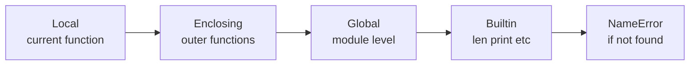

# Python Fundamentals

> **TL;DR**: The Python screen for an AI role isn't a syntax quiz — it's a trap detector. Interviewers probe the handful of features where Python's behavior surprises people: mutability and mutable defaults, closures that capture late, generators as the streaming primitive, decorators that lose their identity, and context managers that swallow exceptions. Get those five airtight, know when a `dataclass` should be a Pydantic model, and you clear the screen. Everything else is just fluent typing.

**Prerequisites**: [What is Python for AI?](what-is-python-for-ai.md)
**Related**: [Internals & Performance](02-internals-and-performance.md), [Async & Concurrency](03-async-and-concurrency.md), [AI / Backend Python](04-ai-backend-python.md)

---

## Mutability, Scope, and the LEGB Rule

Every name in Python is a reference to an object. Some objects are **immutable** (`int`, `str`, `tuple`, `frozenset`) — you can't change them, only rebind the name. Others are **mutable** (`list`, `dict`, `set`, most custom classes) — and that's where bugs live, because two names can point at the same mutable object.

Name lookup follows **LEGB**: Local → Enclosing → Global → Built-in. You read from any of those scopes for free; to *rebind* a name in an outer scope you need `global` or `nonlocal`.



*This chain is for reads only; rebinding a name in an outer scope needs `global` or `nonlocal`.*

The two classics interviewers reach for:

```python
# 1. Mutable default argument — evaluated ONCE, at def time, then shared
def add(item, bucket=[]):        # bucket is the SAME list every call
    bucket.append(item)
    return bucket
add(1); add(2)                   # → [1, 2], not [2]

def add(item, bucket=None):      # the fix
    bucket = [] if bucket is None else bucket
    bucket.append(item)
    return bucket

# 2. Closure late-binding — i is looked up when the lambda RUNS, not when defined
fns = [lambda: i for i in range(3)]
[f() for f in fns]               # → [2, 2, 2]
fns = [lambda i=i: i for i in range(3)]   # bind now via default arg
[f() for f in fns]               # → [0, 1, 2]
```

> Both bugs share a root cause: people assume "at definition time" when Python means "at call time," or vice versa. Default args freeze at `def`; closures resolve at call. Say that sentence in the interview and you've shown you understand it.

---

## Comprehensions

Comprehensions are the idiomatic build-a-collection tool — faster than an explicit loop with `.append` (the append is inlined) and clearer. Know all four forms and when a generator expression beats a list comprehension.

```python
squares  = [x*x for x in nums]              # list
lengths  = {w: len(w) for w in words}       # dict
uniq     = {w.lower() for w in words}       # set
stream   = (embed(c) for c in chunks)       # generator — lazy, no list built
```

Reach for a **generator expression** `( ... )` instead of a list `[ ... ]` when you only iterate once and the input is large — you avoid materializing the whole thing in memory. That single-character change is the difference between streaming a million chunks and OOMing on them.

---

## Iterators and Generators — the Streaming Primitive

This is the highest-leverage topic in the chapter for AI work, because **streaming is generators**. Token-by-token model output, chunking a huge document, paging through a vector store — all of it is "produce values lazily, one at a time, without holding them all in memory."

- An **iterator** implements `__next__` (and `__iter__` returning itself), raising `StopIteration` when exhausted.
- A **generator** is the easy way to build one: any function with `yield`. Calling it returns a generator object; execution is paused between `yield`s and resumed on each `next()`.

```python
def chunk_document(text: str, size: int = 1000):
    """Yield fixed-size chunks lazily — never holds the whole doc in a list."""
    for i in range(0, len(text), size):
        yield text[i : i + size]

# Adapting a streaming LLM response is the same shape:
def stream_tokens(response):
    for event in response:
        yield event.delta            # caller sees tokens as they arrive
```

> **Generators are single-use.** Once exhausted, a generator yields nothing more — iterating it again gives an empty sequence, not a fresh run. If you need to pass streamed data to two consumers, `itertools.tee` it or materialize a list. Forgetting this produces "the second loop did nothing" bugs.

---

## Decorators

A decorator is a function that takes a function and returns a replacement. They wrap cross-cutting behavior — timing, retries, caching, auth — around a call without editing its body. The one thing you must not forget is `functools.wraps`, or the wrapper erases the original's name, docstring, and signature.

```python
import functools, time

def retry(times: int = 3):
    def deco(fn):
        @functools.wraps(fn)                     # preserve fn's identity
        def wrapper(*args, **kwargs):
            for attempt in range(times):
                try:
                    return fn(*args, **kwargs)
                except Exception:
                    if attempt == times - 1:
                        raise
                    time.sleep(2 ** attempt)     # exponential backoff
        return wrapper
    return deco

@retry(times=5)
def call_llm(prompt): ...
```

> **`functools.lru_cache` on an `async def` is a trap.** It caches the *coroutine object* the function returns, not the awaited result — and a coroutine can only be awaited once, so the second cache hit blows up. Cache the result inside the coroutine, or use an async-aware cache. (More on this in [Async & Concurrency](03-async-and-concurrency.md).)

---

## Context Managers

A context manager guarantees setup/teardown around a block via `with`. It's how you make resource cleanup exception-safe: files, DB connections, locks, HTTP sessions. Implement `__enter__`/`__exit__`, or write a generator with `@contextlib.contextmanager`.

```python
from contextlib import contextmanager

@contextmanager
def timer(label: str):
    start = time.perf_counter()
    try:
        yield                                    # the with-body runs here
    finally:
        print(f"{label}: {time.perf_counter() - start:.3f}s")

with timer("embed batch"):
    embed_all(chunks)
```

> **`__exit__` returning `True` swallows the exception.** If your `__exit__` returns a truthy value, any exception raised inside the `with` block is suppressed — silently. Return `None`/`False` unless you *mean* to swallow it. This is a favorite "spot the bug" question.

---

## `*args` / `**kwargs`

`*args` collects extra positional arguments into a tuple; `**kwargs` collects extra keyword arguments into a dict. They're how you write pass-through wrappers (decorators above rely on them) and forward config you don't want to enumerate.

```python
def make_request(url, **kwargs):
    defaults = {"timeout": 30, "retries": 3}
    return _send(url, **{**defaults, **kwargs})   # caller overrides defaults
```

Use `*` alone in a signature to force **keyword-only** arguments — invaluable for API clarity: `def embed(text, *, model, dimensions=None)` makes `model` un-passable by position, so callers can't silently swap argument order.

---

## Dataclasses vs Pydantic

`@dataclass` generates `__init__`, `__repr__`, `__eq__` from annotated fields — a low-ceremony container. It does **no runtime validation**: type hints are documentation the interpreter ignores. Mutable-default rules apply here too, so you need `field(default_factory=...)`.

```python
from dataclasses import dataclass, field

@dataclass
class Chunk:
    text: str
    embedding: list[float] = field(default_factory=list)   # NOT = []
    score: float = 0.0
```

The question they actually ask: **dataclass or Pydantic?**

| | `@dataclass` | Pydantic `BaseModel` |
|---|---|---|
| Runtime validation | None — hints ignored | Yes — coerces & validates on init |
| Cost | Zero deps, fast | Validation overhead |
| Use when | Trusted internal data | Parsing untrusted input (API bodies, LLM JSON) |

Rule of thumb: **at the boundary, use Pydantic** — request bodies, LLM structured output, config from the environment — because you want the bad data to fail loudly at the edge. Internally, a dataclass is fine. (Pydantic gets its own treatment in [AI / Backend Python](04-ai-backend-python.md).)

---

## Typing, Generics, and Exceptions

Type hints are optional at runtime but load-bearing for tooling — `mypy`/`pyright` catch whole classes of bugs before they ship, and IDEs autocomplete off them. Know modern syntax: `list[str]`, `dict[str, int]`, `str | None` (over `Optional[str]`), and `TypeVar`/`Generic` for reusable containers.

```python
from typing import TypeVar, Generic
T = TypeVar("T")

class Result(Generic[T]):
    def __init__(self, value: T | None, error: str | None = None):
        self.value, self.error = value, error
```

For **exceptions**: catch narrowly, never bare `except:` (it eats `KeyboardInterrupt` and `asyncio.CancelledError` — the latter is a real async bug, since cancellation must propagate). Define custom exception types for your domain, and use `raise ... from err` to preserve the chain. Python 3.11+ adds `ExceptionGroup` and `except*` for handling multiple concurrent failures at once — exactly what `TaskGroup` raises when several child tasks fail together.

---

## Serialization

Turning objects into bytes and back. Two you'll meet constantly:

- **JSON** — the interchange default. Human-readable, cross-language, but only knows dicts/lists/strings/numbers/bools/null. It's the *wrong* container for a `float32` embedding array: verbose, lossy on precision, and slow to parse a million floats. Use a binary format (`.npy`, Arrow, raw bytes) for vectors.
- **`pickle`** — Python-native, handles arbitrary objects, but **unpickling untrusted data is remote code execution**. Never `pickle.loads()` bytes from a client or a cache you don't fully control. Say "RCE" out loud when asked; it's the answer they want.

---

## Interview Cheat Sheet

| They ask... | The crisp answer |
|---|---|
| "What's wrong with `def f(x=[])`?" | The list is created once at `def` time and shared across calls. Use `x=None` then `x = x or []`, or `field(default_factory=list)` in a dataclass. |
| "Why does this closure print the same number?" | Late binding — the loop variable is looked up when the lambda runs, not when it's defined. Capture it with a default arg `lambda i=i: i`. |
| "When a generator over a list?" | Iterate once + large/streaming input → generator, constant memory. Need random access or reuse → list. Generators are single-use. |
| "dataclass or Pydantic?" | Dataclass = no runtime validation, internal trusted data. Pydantic = validates/coerces at init, use at every untrusted boundary. |
| "Why is `lru_cache` on an async function broken?" | It caches the coroutine object, which can only be awaited once. Second hit raises. Cache the result, not the coroutine. |
| "Is pickle safe?" | Not on untrusted input — `pickle.loads` can execute arbitrary code (RCE). Use JSON for interchange, binary formats for vectors. |

---

**Key takeaway**: The screen isn't testing syntax — it's testing whether you know the five places Python surprises people: mutable defaults, late-binding closures, single-use generators, identity-losing decorators, and exception-swallowing context managers. Nail those, know dataclass-vs-Pydantic and pickle's RCE risk, and you clear it.

Next: [Internals & Performance](02-internals-and-performance.md) — the GIL, memory, Big-O of the built-in collections, and why your code is actually slow.
