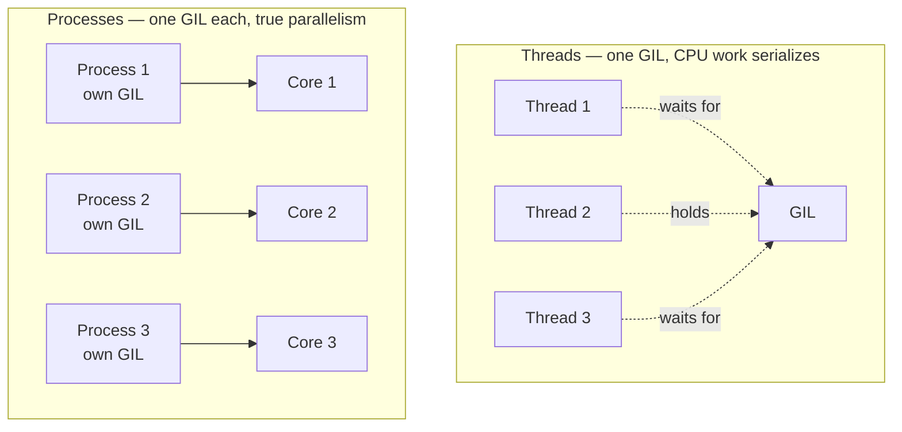

# Internals & Performance

> **TL;DR**: You don't need to have written CPython, but you do need to explain the GIL without hand-waving, because it decides *how* you scale — threads for I/O, processes for CPU. Add three more things: the Big-O of the built-in collections (interviewers love `list.pop(0)` vs `deque.popleft()`), the difference between shallow and deep copy (it silently corrupts agent message history), and how to actually find a hot spot with a profiler. That's the "why is this slow" toolkit.

**Prerequisites**: [Python Fundamentals](01-python-fundamentals.md)
**Related**: [Async & Concurrency](03-async-and-concurrency.md), [AI / Backend Python](04-ai-backend-python.md), [Inference Infrastructure](../06-production-and-ops/04-inference-infrastructure.md)

---

## The GIL — the One They Always Ask

The **Global Interpreter Lock** is a mutex inside CPython that lets only **one thread execute Python bytecode at a time**. It exists because CPython's memory management — reference counting, below — isn't thread-safe, and a single global lock was the cheap way to make the interpreter correct.

The consequence that matters: **Python threads cannot run CPU-bound work in parallel.** Spin up eight threads to crunch numbers on an 8-core box and they take turns holding the GIL — you get concurrency, not parallelism, and often *slower* than one thread because of lock contention.

But there's a crucial escape hatch. **A thread releases the GIL while it waits on I/O** — a network read, a disk read, a `time.sleep`. So for I/O-bound work, threads *do* overlap: while thread A is blocked on a socket (GIL released), thread B runs Python. This is exactly why threads work for I/O and why [async](03-async-and-concurrency.md) can wait on thousands of LLM calls on one thread. Well-written C extensions (NumPy, PyTorch) do the same — they drop the GIL around heavy native compute, so a NumPy matmul can use multiple cores even from threaded Python.



The decision rule falls straight out of this:

| Workload | Tool | Why |
|---|---|---|
| I/O-bound, high concurrency | `asyncio` (or threads) | GIL released during waits; one thread suffices |
| CPU-bound (pure Python) | `multiprocessing` | Each process has its own GIL → real parallelism |
| CPU-bound in C (NumPy/PyTorch) | Threads are fine | The library releases the GIL around native compute |

> The GIL isn't forever. Free-threaded CPython builds are arriving — 3.13 shipped an experimental no-GIL build — so treat the GIL as a *current* engineering constraint, not a permanent law. In interviews, describe today's behavior and note the direction of travel.

---

## Memory: Reference Counting and the GC

CPython tracks every object's **reference count**. Each new reference bumps it; each dropped reference decrements it; at zero, the object is freed *immediately*. That's why memory is usually reclaimed promptly and deterministically — no waiting for a collector.

Refcounting alone can't free **reference cycles** (A points to B, B points to A, both unreachable but each keeps the other's count above zero). A separate **cyclic garbage collector** runs periodically to find and reclaim those. You can `gc.collect()` manually, or `gc.disable()` in a short-lived batch job to skip the overhead when you know you won't build cycles.

> Practical AI angle: large tensors and model objects hold a lot of memory. Dropping the last Python reference frees it *now* under refcounting — which is why `del big_tensor` (plus `torch.cuda.empty_cache()` for GPU memory) actually helps, unlike in a purely tracing-GC language where you'd just hint and hope.

---

## Shallow vs Deep Copy

`copy.copy()` makes a **shallow** copy — a new outer container whose elements are the *same* objects. `copy.deepcopy()` recursively copies all the way down. The gotcha is mutation through the shared inner objects.

```python
import copy
history = [{"role": "user", "content": "hi"}]
snapshot = copy.copy(history)          # new list, SAME dict inside
snapshot[0]["content"] = "HACKED"
history[0]["content"]                  # → "HACKED"  (mutated the original!)
```

This bites AI code specifically: copy an agent's **message list** shallowly, mutate one message to redact or edit it, and you've just corrupted the original conversation history. When you need an independent branch of state, `deepcopy` it (or rebuild immutably).

---

## Hash Tables and Collection Complexity

`dict` and `set` are **hash tables**: they compute `hash(key)` to find a slot, giving average **O(1)** lookup, insert, and delete. Worst case degrades to O(n) under heavy collisions, and keys must be **hashable** (immutable) — that's why you can key a dict on a `tuple` but not a `list`. This O(1) membership test is why "use a set / hashmap" is the answer to half of all coding-screen problems ([Coding Interviews](05-coding-interviews.md)).

Know this table cold — the row that gets asked is `list` front-operations vs `deque`:

| Operation | `list` | `dict` / `set` | `deque` |
|---|---|---|---|
| Index / lookup by key | O(1) | O(1) avg | O(n) (middle) |
| Append / add (end) | O(1) amortized | O(1) avg | O(1) |
| Insert / pop at **front** | **O(n)** | — | **O(1)** |
| Membership (`x in`) | O(n) | O(1) avg | O(n) |
| Pop at end | O(1) | — | O(1) |

```python
from collections import deque
q = deque()
q.append(x); q.popleft()      # O(1) both ends — the right FIFO queue

lst = []
lst.append(x); lst.pop(0)     # pop(0) is O(n) — shifts every element left
```

> If you're doing FIFO with `list.pop(0)`, you've written an accidental O(n²) loop. `collections.deque` is O(1) at both ends — that's the whole reason it exists. Same story for a work queue in an ingestion pipeline.

---

## Multiprocessing vs Threading

Threads share one memory space and one GIL — cheap to spawn, great for I/O, useless for parallel CPU. Processes each get their own interpreter, own GIL, own memory — real parallelism, but you pay to **pickle** arguments and results across the process boundary.

Two operational traps worth a sentence each in an interview:

- **`spawn` vs `fork`.** `fork` (Linux default, historically) copies the parent process cheaply but inherits its threads and locks in a possibly-broken state; `spawn` (macOS/Windows default) starts fresh and must **pickle** everything you pass. Big non-picklable arguments blow up under `spawn`.
- **Don't fork after CUDA/threads are live.** Forking a process that has already initialized CUDA (or a thread pool) leads to hangs and corrupted GPU state. Create your process pool *before* touching the GPU, or use `spawn`.

---

## Profiling — Measure Before You Optimize

Never guess at the hot spot. The tools, and the AI-specific caveat:

- **`cProfile`** — deterministic, per-function call counts and cumulative time. Great for **CPU** hot spots: tokenizing, chunking, JSON parsing of big payloads. **Near-useless on async I/O**, where the time is spent *waiting* on the network, not running Python — it'll just show you blocked on `await`.
- **`py-spy`** — a sampling profiler that attaches to a **live** process without modifying it. This is what you run against a production server to find where real traffic is spending time.
- **`timeit`** — micro-benchmark a single expression, correctly (handles warm-up and repetition).

```python
import cProfile
cProfile.run("build_index(docs)", sort="cumtime")   # CPU-bound indexing
```

The rule: profile first, and profile the *right* dimension — CPU time for compute, wall-clock/tracing for I/O. Optimizing an unmeasured guess is how you speed up the 2% and ship the 98% unchanged.

---

## Memory Optimization

When object count or footprint is the problem:

- **`__slots__`** — declaring `__slots__ = ("a", "b")` on a class drops its per-instance `__dict__`, cutting memory substantially and speeding attribute access. Worth it when you hold millions of small objects (parsed records, graph nodes).
- **Use the right container for numbers.** A Python `list` of floats stores boxed `float` objects with pointers — roughly **8× the memory** of the equivalent `float32` NumPy array, which packs raw values contiguously. For embeddings and any bulk numeric data, that's not a micro-optimization; it's the difference between fitting in RAM and not. (See [Embedding Models](../03-retrieval-and-rag/02-embedding-models.md).)
- **Generators over lists** — stream instead of materialize when you only pass through once ([Fundamentals](01-python-fundamentals.md)).

---

## Interview Cheat Sheet

| They ask... | The crisp answer |
|---|---|
| "What is the GIL and why does it exist?" | A mutex letting one thread run Python bytecode at a time; it makes refcounting thread-safe. It blocks parallel CPU in threads but is released during I/O and by C extensions. |
| "Threads or processes for a CPU task?" | Processes — each has its own GIL, so it's true parallelism. Threads only help CPU if the work is in a C library that releases the GIL. |
| "`list.pop(0)` vs `deque.popleft()`?" | `pop(0)` is O(n) (shifts everything); `deque.popleft()` is O(1). Use `deque` for any queue. |
| "Shallow vs deep copy gotcha?" | Shallow copy shares the inner objects — mutating a nested dict changes the original. Deepcopy for independent state (e.g. branching message history). |
| "How do you find why it's slow?" | Profile, don't guess: `cProfile` for CPU hot spots, `py-spy` on a live server; cProfile is useless on async I/O since the time is spent waiting. |
| "Cut memory on millions of objects?" | `__slots__` to drop per-instance dicts; `float32` NumPy arrays over Python float lists (~8× smaller); generators to avoid materializing. |

---

**Key takeaway**: The GIL is the load-bearing concept — it serializes CPU work in threads but releases on I/O, which is exactly why you reach for processes to parallelize compute and async to scale I/O. Round it out with the collection Big-O table, the shallow-copy trap, and profiling the right dimension, and "why is this slow" stops being a mystery.

Next: [Async & Concurrency](03-async-and-concurrency.md) — the event loop, `gather`, semaphores, and waiting on thousands of LLM calls at once.
