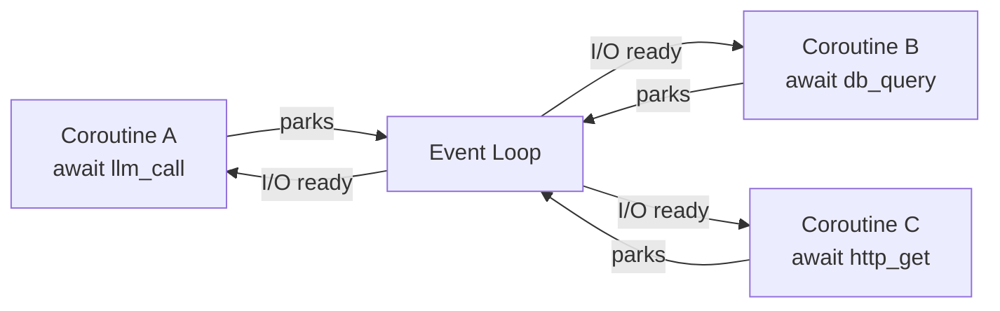

# Async and Concurrency

> **TL;DR**: AI backends spend almost all their time *waiting* — for an LLM to stream tokens, for a vector DB to answer, for a tool's HTTP call to return. That's I/O-bound work, and `asyncio` is how you wait on hundreds of those at once on a single thread. Master five things — the event loop, `async/await`, `gather`, a `Semaphore` to cap concurrency, and timeouts/cancellation — and you can write a RAG or agent server that fans out 100 LLM calls without spawning 100 threads.

**Prerequisites**: [Python Fundamentals](01-python-fundamentals.md), [Internals & Performance](02-internals-and-performance.md) (the GIL)
**Related**: [AI / Backend Python](04-ai-backend-python.md), [Inference Infrastructure](../06-production-and-ops/04-inference-infrastructure.md)

---

## Why Async, Not Threads

There are two kinds of "slow": **CPU-bound** (you're computing — matrix math, parsing) and **I/O-bound** (you're waiting on the network or disk). Almost everything an AI application does is I/O-bound: the model is running on someone else's GPU, the vectors live in someone else's database.

Because of the **GIL** (see [Internals & Performance](02-internals-and-performance.md)), Python threads can't run CPU work in parallel — but they *can* release the GIL while waiting on I/O. So threads work for I/O too. The problem is cost: each OS thread carries ~8 MB of stack and a context-switch tax. Fan out 500 concurrent LLM calls with threads and you're paying for 500 threads to sit idle.

`asyncio` does the same waiting on **one thread**. A coroutine that hits `await` hands control back to the event loop, which runs someone else's coroutine until *its* I/O is ready. No thread-per-request, no lock juggling.

| | Threads | asyncio |
|---|---|---|
| Good for | Blocking libraries, some CPU via releasing GIL | High-concurrency I/O (LLM/DB/HTTP) |
| Cost per task | ~MBs (OS thread) | ~KBs (coroutine object) |
| Concurrency ceiling | Hundreds | Tens of thousands |
| Failure mode | Deadlocks, races | One blocking call freezes *everything* |

> **The one rule that bites everyone:** never call a blocking function inside a coroutine. One `requests.get()` or `time.sleep()` stalls the *entire* event loop — every other request hangs. Use `httpx.AsyncClient`, `await asyncio.sleep()`, or push the blocking call to a thread with `asyncio.to_thread()`.

---

## The Event Loop

The event loop is a single-threaded scheduler running a simple loop: *run coroutines until they hit `await`, park them, wake them when their I/O is ready, repeat.*



You rarely touch the loop directly. `asyncio.run(main())` creates it, runs your top-level coroutine to completion, and tears it down.

```python
import asyncio

async def main():
    ...

asyncio.run(main())   # creates loop, runs main(), closes loop
```

---

## Coroutines, Tasks, and Futures

- **Coroutine** — what `async def` returns *when you call it*. Inert until awaited or scheduled. `coro = fetch()` does nothing; `await fetch()` runs it.
- **Task** — a coroutine handed to the loop to run **concurrently** in the background: `asyncio.create_task(fetch())`. This is the moment concurrency actually starts.
- **Future** — a low-level "result that isn't ready yet." You mostly see these under the hood; a Task *is* a Future.

The distinction that trips people up:

```python
# SEQUENTIAL — each await blocks until done. 3 calls × 2s = 6s
a = await fetch(1)
b = await fetch(2)
c = await fetch(3)

# CONCURRENT — all three start immediately, then we wait. ~2s total
a, b, c = await asyncio.gather(fetch(1), fetch(2), fetch(3))
```

---

## `asyncio.gather` — Fan Out and Collect

`gather` is the workhorse: launch many coroutines, wait for all, get results **in order**.

```python
async def embed_all(chunks: list[str]) -> list[list[float]]:
    return await asyncio.gather(*(embed(c) for c in chunks))
```

By default, if one coroutine raises, `gather` propagates that exception and the rest keep running orphaned. In a batch job you usually want the opposite — collect failures instead of aborting:

```python
results = await asyncio.gather(*tasks, return_exceptions=True)
oks   = [r for r in results if not isinstance(r, Exception)]
fails = [r for r in results if isinstance(r, Exception)]
```

> For large or streaming fan-outs, prefer `asyncio.as_completed()` (process results as they land) or `TaskGroup` (Python 3.11+, structured concurrency — if any child fails, siblings are cancelled cleanly).

---

## Semaphores — Cap Concurrency Before the Rate Limiter Does

`gather` over 10,000 chunks will try to open 10,000 connections at once — and your LLM provider will answer with `429 Too Many Requests`. A **semaphore** bounds how many coroutines are in the critical section at any moment.

```python
sem = asyncio.Semaphore(20)   # at most 20 in flight

async def bounded_embed(chunk: str):
    async with sem:
        return await embed(chunk)

results = await asyncio.gather(*(bounded_embed(c) for c in chunks))
```

This is the single most important pattern for real LLM pipelines: **fan out wide, but throttle to the provider's concurrency limit.** Tune the number to your rate limit, not your ambition.

---

## Timeouts and Cancellation

A hung upstream call must not hang your request forever. Two tools:

```python
# Bound a single call (Python 3.11+)
async with asyncio.timeout(30):
    answer = await llm_call(prompt)

# Older / inline style
answer = await asyncio.wait_for(llm_call(prompt), timeout=30)
```

When a timeout fires, the coroutine is **cancelled** — a `CancelledError` is raised *inside* it at the next `await`. Clean up in a `finally`, and never swallow `CancelledError`:

```python
try:
    await do_work()
except asyncio.CancelledError:
    await release_resources()
    raise          # re-raise — cancellation must propagate
```

---

## Backpressure — Don't Accept Faster Than You Can Serve

Backpressure is the system telling upstream "slow down." Without it, a burst of requests grows an unbounded queue in memory until the process OOMs. An `asyncio.Queue` with a **`maxsize`** gives it to you for free: producers `await queue.put()` and block once the queue is full.

```python
queue = asyncio.Queue(maxsize=100)   # bounded → natural backpressure

async def producer():
    async for req in incoming:
        await queue.put(req)          # blocks when 100 are pending

async def worker():
    while True:
        req = await queue.get()
        await handle(req)
        queue.task_done()
```

Pair a bounded queue with a fixed pool of workers and you have a throughput-limited, memory-safe pipeline — the backbone of any ingestion or agent-execution service.

---

## Interview Cheat Sheet

| They ask... | The crisp answer |
|---|---|
| "Why asyncio over threads for LLM calls?" | I/O-bound + high concurrency; one thread, thousands of coroutines, no GIL fight, no thread overhead. |
| "What breaks the event loop?" | Any blocking call (`requests`, `time.sleep`, heavy CPU) — it stalls *every* task. Use async libs or `to_thread`. |
| "How do you avoid rate limits when embedding 1M chunks?" | `gather` + `Semaphore(N)` to cap in-flight calls to the provider's limit, plus retries with backoff. |
| "coroutine vs task?" | Coroutine is inert until awaited; a task schedules it to run concurrently right now. |
| "How do you stop a slow call?" | `asyncio.timeout()` / `wait_for()` → cancellation → clean up in `finally`, re-raise `CancelledError`. |

---

**Key takeaway**: AI workloads are waiting games. `asyncio` lets one thread wait on thousands of LLM/DB/HTTP calls at once — but only if you never block the loop, and you cap concurrency with a semaphore before the provider's rate limiter caps it for you.

Next: [AI / Backend Python](04-ai-backend-python.md) — FastAPI, streaming, Pydantic, and putting async to work.
