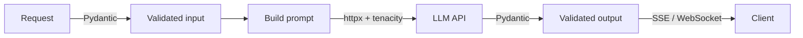

# AI / Backend Python

> **TL;DR**: An AI feature is mostly plumbing around one model call. **Pydantic** validates the messy JSON going in and coming out, **FastAPI** serves it async, **SSE** streams tokens to the browser, and **httpx + tenacity** make the provider call survive 429s. Add batching, a cache, and structured logs and you've shipped a real backend. This is the "glue that ships an AI backend" — not glamorous, but it's what separates a demo from production.

**Prerequisites**: [Python Fundamentals](01-python-fundamentals.md), [Async and Concurrency](03-async-and-concurrency.md)
**Related**: [Structured Generation](../02-prompt-engineering/03-structured-generation.md), [Observability & Tracing](../06-production-and-ops/01-observability-and-tracing.md), [Cost Optimization](../06-production-and-ops/07-cost-optimization.md)

---

## The Shape of an AI Backend

Almost every LLM feature is the same pipeline: **validate input → build prompt → call the model (with retries) → validate output → stream or return it**, wrapped in logging and a cache. Learn the tools for each stage and you can build any of them.



---

## Pydantic — Your Contract at Both Boundaries

Pydantic v2 parses untrusted data into typed Python objects and **raises on anything malformed**. You use it twice: for the HTTP request body, and — critically — to coerce the model's JSON into a real object.

```python
from pydantic import BaseModel, Field

class ChatRequest(BaseModel):
    message: str = Field(min_length=1, max_length=8000)
    temperature: float = Field(0.7, ge=0.0, le=2.0)
    stream: bool = False

class Sentiment(BaseModel):        # the shape you force the LLM to emit
    label: str = Field(pattern="^(positive|negative|neutral)$")
    confidence: float = Field(ge=0, le=1)

# Model returned text that is supposedly JSON:
result = Sentiment.model_validate_json(llm_output)   # raises ValidationError if off
```

This is the backbone of **structured generation**: you hand the JSON schema (`Sentiment.model_json_schema()`) to the provider's structured-output / tool-calling API, then validate what comes back. See [Structured Generation](../02-prompt-engineering/03-structured-generation.md) and [Tool Use & Function Calling](../04-agents-and-orchestration/02-tool-use-and-function-calling.md).

> **Settings live here too.** `pydantic-settings`' `BaseSettings` loads config from env vars with types and defaults — the right way to read `OPENAI_API_KEY`, not `os.environ[...]` scattered everywhere.

```python
from pydantic_settings import BaseSettings

class Settings(BaseSettings):
    openai_api_key: str
    max_concurrency: int = 20
    model: str = "gpt-4o-mini"

settings = Settings()   # reads env, validates, fails fast on missing keys
```

---

## FastAPI — Async Endpoints, Free Validation

FastAPI reads your Pydantic models and type hints to validate requests, generate OpenAPI docs, and inject dependencies. Declare handlers `async def` so one worker serves many in-flight LLM calls (see [Async and Concurrency](03-async-and-concurrency.md)).

```python
from fastapi import FastAPI, HTTPException

app = FastAPI()

@app.post("/chat")
async def chat(req: ChatRequest) -> dict:
    try:
        answer = await call_llm(req.message, req.temperature)
    except ProviderError:
        raise HTTPException(status_code=502, detail="upstream model error")
    return {"answer": answer}
```

> **The classic FastAPI footgun:** a `def` handler runs in a threadpool; an `async def` handler runs *on the event loop*. Put a blocking call (`requests.get`, `time.sleep`, a sync DB driver) inside an `async def` and you freeze every concurrent request. Use async clients, or offload with `await asyncio.to_thread(...)`.

---

## Streaming with SSE — Tokens as They Land

Users shouldn't stare at a spinner for 8 seconds. **Server-Sent Events (SSE)** is a one-way HTTP stream — dead simple, works through proxies, and it's what most chat UIs use. You yield an async generator; FastAPI flushes each chunk.

```python
from fastapi.responses import StreamingResponse

async def token_stream(prompt: str):
    async for token in llm_stream(prompt):     # provider's async token iterator
        yield f"data: {token}\n\n"             # SSE frame: "data: ...\n\n"
    yield "data: [DONE]\n\n"

@app.post("/chat/stream")
async def chat_stream(req: ChatRequest):
    return StreamingResponse(
        token_stream(req.message),
        media_type="text/event-stream",
    )
```

The wire format is the whole trick: each event is `data: <payload>\n\n`. The browser reads it with `EventSource` (or `fetch` + a stream reader). Send `[DONE]` so the client knows when to stop.

| | SSE | WebSocket |
|---|---|---|
| Direction | Server → client only | Full duplex |
| Protocol | Plain HTTP | Upgraded TCP |
| Reconnect | Automatic (`EventSource`) | You handle it |
| Use for | Streaming LLM tokens, progress | Live agents, voice, collaboration |

---

## WebSockets — When You Need Both Directions

Reach for WebSockets when the client also talks *back* mid-stream: interrupting a generation, a voice loop, or a multi-turn agent that pushes tool-call updates. It's a persistent bidirectional connection.

```python
from fastapi import WebSocket

@app.websocket("/ws")
async def ws(sock: WebSocket):
    await sock.accept()
    try:
        while True:
            prompt = await sock.receive_text()
            async for token in llm_stream(prompt):
                await sock.send_text(token)
    except WebSocketDisconnect:
        pass   # client left; drop the connection
```

> Default to SSE for one-way token streaming — it's simpler and reconnects itself. Only pay the WebSocket complexity tax when you genuinely need the client-to-server channel while the server is streaming.

---

## NumPy & Pandas — The Data Layer

**NumPy** is the array. Embeddings are `float32` vectors; similarity is a dot product. Know that vectorized ops run in C — never loop over rows in Python.

```python
import numpy as np

def cosine(a: np.ndarray, b: np.ndarray) -> float:
    return float(a @ b / (np.linalg.norm(a) * np.linalg.norm(b)))
# Batch: (N, d) matrix @ (d,) query → (N,) scores in one C call
scores = embeddings @ query        # vectorized, no Python loop
```

**Pandas** is the DataFrame — how you wrangle eval sets, label CSVs, and inspect logs. Know `read_csv`, `df[df.score > 0.8]` boolean masking, `groupby().agg()`, and `.apply()` (convenient but slow — vectorize when it matters). You mostly meet these in [Embedding Models](../03-retrieval-and-rag/02-embedding-models.md) and RAG eval work.

---

## PyTorch — Just the Vocabulary

For a backend role you rarely train, but you must speak the language. Two concepts:

- **Tensor** — an n-dimensional array (like NumPy) that also lives on a **GPU** (`.to("cuda")`) and remembers operations for gradients.
- **Autograd** — PyTorch records a graph of your ops; `loss.backward()` walks it backward to compute every gradient automatically. That's the engine under training.

```python
import torch

x = torch.tensor([2.0], requires_grad=True)
y = x ** 2
y.backward()          # dy/dx = 2x
print(x.grad)         # tensor([4.])
```

Know: tensors vs NumPy (GPU + autograd), `model.eval()` + `torch.no_grad()` for inference, and that `float16`/`bf16` halves memory. Deep serving details live in [Inference Infrastructure](../06-production-and-ops/04-inference-infrastructure.md).

---

## HTTP Clients — Use `httpx`, Async

`requests` is blocking and will freeze your event loop. `httpx.AsyncClient` is the async-native replacement — and **reuse one client** so connections are pooled, not reopened per call.

```python
import httpx

client = httpx.AsyncClient(timeout=30.0)   # one shared client, pooled connections

async def call_llm(prompt: str) -> str:
    resp = await client.post(URL, json={"prompt": prompt}, headers=HEADERS)
    resp.raise_for_status()
    return resp.json()["text"]
```

---

## Retries & Backoff — Survive the 429

LLM providers rate-limit and have transient blips. A robust client retries `429` and `5xx` with **exponential backoff + jitter** (jitter spreads retries so clients don't stampede in sync). `tenacity` makes it declarative:

```python
from tenacity import retry, wait_random_exponential, stop_after_attempt, retry_if_exception_type

@retry(
    wait=wait_random_exponential(min=1, max=60),   # backoff + jitter
    stop=stop_after_attempt(6),
    retry=retry_if_exception_type(httpx.HTTPStatusError),
)
async def call_llm(prompt: str) -> str:
    resp = await client.post(URL, json={"prompt": prompt})
    resp.raise_for_status()
    return resp.json()["text"]
```

The manual version, so you can whiteboard it:

```python
for attempt in range(6):
    try:
        return await do_call()
    except RateLimited:
        await asyncio.sleep(min(60, 2 ** attempt) + random.random())   # jittered
raise
```

> Retry only **transient** errors (429, 500, 502, 503, timeouts). Retrying a `400 bad request` just wastes tokens and money — it'll fail identically every time. Pair retries with a `Semaphore` to cap concurrency *before* you hit the limit (see [Async and Concurrency](03-async-and-concurrency.md)).

---

## Batching, Caching, Structured Logging

**Batching** — embedding APIs take a *list* of inputs per call. One request of 100 texts beats 100 requests: fewer round-trips, better throughput, lower cost. Buffer inputs, flush at a size or time threshold.

**Caching** — identical prompts are common (system prompts, repeated questions). Cache on a hash of the request; an exact-match cache hit costs $0 and 0ms.

```python
import hashlib, functools

def prompt_key(prompt: str, model: str) -> str:
    return hashlib.sha256(f"{model}:{prompt}".encode()).hexdigest()

# In-process demo; use Redis for a real multi-worker cache with TTL.
@functools.lru_cache(maxsize=10_000)
def cached_embed(text: str) -> tuple[float, ...]:
    return tuple(embed(text))
```

Also know **semantic caching** (return a cached answer when a *new* prompt is embedding-similar to a past one) and provider **prompt caching** — both in [Cost Optimization](../06-production-and-ops/07-cost-optimization.md).

**Structured logging** — log JSON, not f-strings. `{"event": "llm_call", "model": "...", "latency_ms": 812, "tokens": 1200, "request_id": "..."}` is queryable; `f"took {t}ms"` is not. Attach a **request_id** and propagate it so you can trace one request across services — the foundation of [Observability & Tracing](../06-production-and-ops/01-observability-and-tracing.md).

```python
import structlog
log = structlog.get_logger()
log.info("llm_call", model=settings.model, latency_ms=812, tokens=1200, request_id=rid)
```

---

## Interview Cheat Sheet

| They ask... | The crisp answer |
|---|---|
| "Why Pydantic for LLM output?" | It parses the model's JSON into a typed object and raises on anything malformed — the validation half of structured generation. |
| "SSE vs WebSocket for streaming?" | SSE for one-way token streaming (simpler, auto-reconnect); WebSocket when the client talks back mid-stream (interrupt, voice, agents). |
| "Blocking call in an async FastAPI route?" | It stalls the whole event loop and every concurrent request. Use async clients or `asyncio.to_thread`. |
| "How do you handle 429s?" | Exponential backoff **with jitter**, retry only transient errors, and cap concurrency with a semaphore before you hit the limit. |
| "How do you cut LLM cost/latency in the backend?" | Batch embedding calls, cache on request hash (exact + semantic), reuse one pooled `httpx` client. |
| "How do you debug a slow request in prod?" | Structured JSON logs with a propagated request_id + latency/token fields — greppable traces, not f-strings. |

---

**Key takeaway**: Shipping an AI feature is 10% model call and 90% plumbing. Pydantic guards both boundaries, FastAPI serves it async, SSE streams the tokens, and httpx + tenacity make the provider call survive real traffic. Master this glue and you can build the backend for any LLM product.

Next: [Coding Interviews](05-coding-interviews.md) — the DSA screen you still have to pass.
