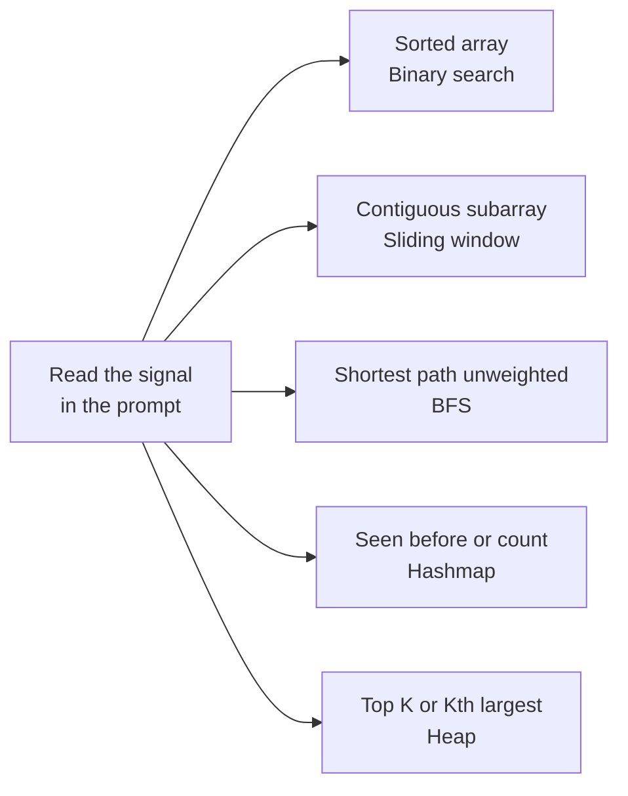

# Coding Interviews (DSA)

> **TL;DR**: The coding screen still exists for AI roles. Before anyone lets you design a RAG pipeline, a 45-minute LeetCode-style round checks you can turn a problem into a correct, efficient algorithm under pressure. The good news: ~12 patterns cover the vast majority of questions. Learn to **recognize the signal** in the prompt — "sorted → binary search," "contiguous window → sliding window," "shortest path → BFS" — state the Big-O out loud, and code it cleanly. This page is the map.

**Prerequisites**: [Python Fundamentals](01-python-fundamentals.md), [Internals & Performance](02-internals-and-performance.md) (collection complexity)
**Related**: [Async and Concurrency](03-async-and-concurrency.md), [AI / Backend Python](04-ai-backend-python.md)

---

## Why This Still Matters for AI Roles

AI engineering is systems work, but the interview funnel usually opens with a data-structures screen — it's the cheapest signal a company has that you can reason about correctness and complexity. Treat it as a solved problem: the same handful of patterns recur, and interviewers care less about the trick than about how you **narrate**: clarify the input, name the pattern, state the complexity, code it, test an edge case.

> **The meta-skill is pattern recognition.** You're not inventing algorithms live — you're mapping a disguised prompt onto a pattern you already know. The table at the bottom is that map; the sections below are each entry in depth.



---

## Arrays & Strings

The default container. Most problems reduce to a scan, a sort, or a clever index dance. In Python, strings are immutable — build with a `list` and `"".join()` rather than `+=` in a loop (which is O(n²)).

- **Reach for it when**: linear data, order matters, or you can sort to expose structure.
- **Big-O**: index O(1), search O(n), sort O(n log n).
- **Classic problem**: *Best Time to Buy/Sell Stock* — one pass tracking the running min.

```python
def max_profit(prices: list[int]) -> int:
    lo, best = float("inf"), 0
    for p in prices:
        lo = min(lo, p)
        best = max(best, p - lo)
    return best
```

---

## Hashmaps

The single highest-leverage structure in interviews. A `dict` (or `set`) trades O(n) memory for O(1) average lookup — it turns nested-loop O(n²) scans into single-pass O(n). If a problem says "have I seen this before?" or "count occurrences," it's a hashmap.

- **Reach for it when**: membership, counting, grouping, or caching a complement.
- **Big-O**: insert / lookup O(1) average (O(n) worst case on collisions).
- **Classic problem**: *Two Sum* — store `value → index`, look up `target - x`.

```python
def two_sum(nums: list[int], target: int) -> list[int]:
    seen: dict[int, int] = {}
    for i, x in enumerate(nums):
        if target - x in seen:
            return [seen[target - x], i]
        seen[x] = i
```

> `collections.Counter` (counting) and `defaultdict(list)` (grouping) are the two you'll reach for constantly. Know them cold.

---

## Stacks & Queues

**Stack** (LIFO) for anything nested or "most recent" — matching brackets, undo, parsing. **Queue** (FIFO) for order-preserving processing — use `collections.deque` for O(1) pops from both ends (a plain `list.pop(0)` is O(n)).

- **Reach for it when**: matched pairs / nesting (stack); level-by-level or FIFO (queue).
- **Big-O**: push / pop O(1) for both.
- **Classic problem**: *Valid Parentheses* — push openers, pop and match on closers.

```python
def is_valid(s: str) -> bool:
    pairs = {")": "(", "]": "[", "}": "{"}
    stack = []
    for c in s:
        if c in pairs:
            if not stack or stack.pop() != pairs[c]:
                return False
        else:
            stack.append(c)
    return not stack
```

---

## Linked Lists

Rarely the point in real work, common in screens because they test pointer discipline. Master three moves: reverse, fast/slow pointers (cycle detection, find middle), and a **dummy head** node to simplify edge cases.

- **Reach for it when**: the problem hands you nodes, or in-place O(1) reordering is required.
- **Big-O**: traverse O(n), insert/delete at a known node O(1).
- **Classic problem**: *Reverse a Linked List* — rewire `next` pointers as you walk.

```python
def reverse(head):
    prev = None
    while head:
        head.next, prev, head = prev, head, head.next
    return prev
```

---

## Trees

Hierarchies: file systems, ASTs, decision trees. Almost everything is a **DFS** (recursion) or **BFS** (level order) traversal. Binary Search Trees give O(log n) search on sorted data (when balanced).

- **Reach for it when**: hierarchical data, "root-to-leaf," or ordered data via a BST.
- **Big-O**: traverse O(n); BST search/insert O(log n) balanced, O(n) skewed.
- **Classic problem**: *Maximum Depth of Binary Tree* — recursive DFS.

```python
def max_depth(root) -> int:
    if not root:
        return 0
    return 1 + max(max_depth(root.left), max_depth(root.right))
```

---

## Graphs & BFS/DFS

The general case of trees (nodes + edges, possibly cyclic). Represent as an adjacency list (`dict[node, list[node]]`). **BFS** finds the shortest path in an *unweighted* graph; **DFS** explores fully — for connectivity, cycles, and topological sort. Always track a `visited` set or you'll loop forever.

- **Reach for it when**: relationships/connections, "shortest path," "number of islands," dependencies.
- **Big-O**: O(V + E) for both BFS and DFS.
- **Classic problem**: *Number of Islands* — flood-fill each unvisited land cell.

```python
from collections import deque

def bfs(graph, start):
    seen, q = {start}, deque([start])
    while q:
        node = q.popleft()
        for nxt in graph[node]:
            if nxt not in seen:
                seen.add(nxt)
                q.append(nxt)
    return seen
```

> BFS uses a **queue** and finds shortest paths; DFS uses a **stack** (or recursion) and goes deep. Picking the wrong one is a common miss — if they say "shortest" or "fewest steps" in an unweighted graph, it's BFS.

---

## Heaps

A binary heap (`heapq`, a min-heap in Python) gives you the smallest element in O(1) and push/pop in O(log n). The go-to for "**top-K**," "K-th largest," "merge K sorted lists," or a streaming median.

- **Reach for it when**: you need the min/max repeatedly, or the top/bottom K without a full sort.
- **Big-O**: push / pop O(log n), peek O(1). Top-K over n items: O(n log k).
- **Classic problem**: *K-th Largest Element* — keep a min-heap of size k.

```python
import heapq

def kth_largest(nums: list[int], k: int) -> int:
    heap = nums[:k]
    heapq.heapify(heap)
    for x in nums[k:]:
        if x > heap[0]:
            heapq.heappushpop(heap, x)
    return heap[0]   # smallest of the top-k = the k-th largest
```

> For a **max-heap**, push negated values (`heapq` is min-only). Top-K with a size-k heap is O(n log k) — better than sorting's O(n log n) when k ≪ n.

---

## Binary Search

If the input is **sorted** (or the answer space is monotonic), you can halve it each step: O(log n). The subtle version is "binary search on the answer" — guessing a value and checking feasibility (e.g., minimum capacity to ship in D days).

- **Reach for it when**: sorted array, or a monotonic "is X feasible?" predicate.
- **Big-O**: O(log n).
- **Classic problem**: *Search in Rotated Sorted Array*.

```python
def bsearch(nums: list[int], target: int) -> int:
    lo, hi = 0, len(nums) - 1
    while lo <= hi:
        mid = (lo + hi) // 2          # Python ints don't overflow
        if nums[mid] == target:
            return mid
        if nums[mid] < target:
            lo = mid + 1
        else:
            hi = mid - 1
    return -1
```

> Use `bisect` from the stdlib for insertion points. The classic bug is the off-by-one in the `lo`/`hi`/`mid` bounds — decide `<` vs `<=` deliberately and stay consistent.

---

## Sliding Window

For **contiguous** subarrays/substrings, a window with two moving edges turns an O(n²) recompute into O(n): expand the right edge, shrink the left when a constraint breaks, track the best.

- **Reach for it when**: "longest/shortest/max-sum **contiguous** subarray or substring."
- **Big-O**: O(n) — each element enters and leaves the window once.
- **Classic problem**: *Longest Substring Without Repeating Characters*.

```python
def longest_unique(s: str) -> int:
    last, best, left = {}, 0, 0
    for right, c in enumerate(s):
        if c in last and last[c] >= left:
            left = last[c] + 1        # jump past the duplicate
        last[c] = right
        best = max(best, right - left + 1)
    return best
```

---

## Two Pointers

Two indices moving through the data — from both ends (in a sorted array) or at different speeds. Collapses many O(n²) problems to O(n) with O(1) space.

- **Reach for it when**: sorted array + pair/triplet target, in-place partition, or palindrome check.
- **Big-O**: O(n) time, O(1) space.
- **Classic problem**: *Two Sum II (sorted input)* / *3Sum*.

```python
def two_sum_sorted(nums: list[int], target: int) -> list[int]:
    i, j = 0, len(nums) - 1
    while i < j:
        s = nums[i] + nums[j]
        if s == target:
            return [i, j]
        if s < target:
            i += 1      # need a bigger sum
        else:
            j -= 1      # need a smaller sum
```

---

## Recursion

The base of trees, graphs, backtracking, and divide-and-conquer. Nail two things: the **base case** (when to stop) and the **recurrence** (shrink toward it). Watch Python's ~1000-frame recursion limit — deep recursion may need an explicit stack.

- **Reach for it when**: a problem is self-similar — subtrees, subsets, permutations, "try all choices."
- **Big-O**: depends on the branching; backtracking is often exponential (O(2^n) subsets, O(n!) permutations).
- **Classic problem**: *Subsets / Permutations* via backtracking.

```python
def subsets(nums: list[int]) -> list[list[int]]:
    out = []
    def backtrack(start, path):
        out.append(path[:])
        for i in range(start, len(nums)):
            path.append(nums[i])
            backtrack(i + 1, path)
            path.pop()               # undo the choice — the essence of backtracking
    backtrack(0, [])
    return out
```

---

## Basic Dynamic Programming

When a problem has **overlapping subproblems** and **optimal substructure**, cache subresults so you solve each once. Start with top-down memoization (recursion + a cache — often just `@functools.cache`), then convert to a bottom-up table if asked.

- **Reach for it when**: "count the ways," "min/max cost," or brute force recomputes the same states.
- **Big-O**: usually O(states × transitions); Fibonacci-style is O(n) with memoization vs O(2^n) naive.
- **Classic problem**: *Climbing Stairs* / *Coin Change* / *House Robber*.

```python
from functools import cache

def climb(n: int) -> int:          # ways to reach step n taking 1 or 2 steps
    @cache
    def dp(i):
        if i <= 2:
            return i
        return dp(i - 1) + dp(i - 2)
    return dp(n)
```

> DP is the pattern people fear most. The unlock: define the **state** ("what does `dp(i)` mean?") and the **transition** ("how does `dp(i)` build from smaller states?"). Get those two sentences right and the code writes itself.

---

## Pattern → Signal → Complexity

| Pattern | Signal in the problem | Typical complexity |
|---|---|---|
| Hashmap | "Seen before?", counting, grouping, complement | O(n) time / O(n) space |
| Two pointers | Sorted array, pair/triplet target, palindrome, in-place | O(n) time / O(1) space |
| Sliding window | Longest/shortest/max **contiguous** subarray or substring | O(n) |
| Binary search | Sorted input, or monotonic "is X feasible?" | O(log n) |
| Stack | Matched pairs, nesting, "most recent," parsing | O(n) |
| Queue / BFS | Level order, **shortest path** in unweighted graph | O(V + E) |
| DFS / recursion | Explore fully, connectivity, subsets/permutations | O(V + E) / exponential |
| Heap | Top-K, K-th largest, merge K lists, streaming median | O(n log k) |
| Trees | Hierarchy, root-to-leaf, ordered data (BST) | O(n) / O(log n) balanced |
| Dynamic programming | "Count ways," min/max cost, overlapping subproblems | O(states × transitions) |

---

## Interview Cheat Sheet

| They ask... | The crisp answer |
|---|---|
| "How do you approach an unseen problem?" | Clarify input/edge cases → name the pattern from the signal → state Big-O → code → test an edge case. |
| "Sorted array — what's your first thought?" | Binary search or two pointers; the sort is doing work for you, exploit the O(log n) / O(1)-space angle. |
| "Longest contiguous substring with property X?" | Sliding window — expand right, shrink left when the constraint breaks, O(n). |
| "Shortest path in an unweighted graph?" | BFS with a queue and a visited set; DFS won't give shortest. |
| "Top K of a stream?" | Size-K heap, O(n log k) — cheaper than sorting when k ≪ n. |
| "When is it DP?" | Overlapping subproblems + optimal substructure. Define the state and transition, memoize. |

---

**Key takeaway**: The AI coding screen is a pattern-matching game, not an IQ test. Recognize the signal in the prompt, map it to one of ~12 patterns, state the complexity before you code, and narrate as you go. Correct-and-clear beats clever-and-buggy every time.

Next: [Python for AI Checklist](00-checklist.md) — tick off every ⭐ topic, then move on to [LLM Foundations](../01-llm-foundations/00-checklist.md).
