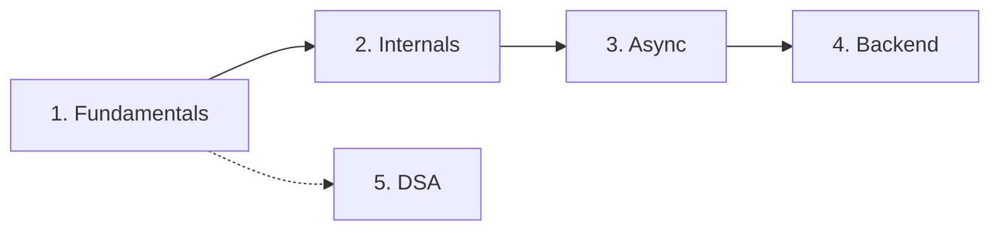

# Python for Applied AI

> **TL;DR**: You're a senior engineer. You've shipped systems. And you'll still get screened on Python and CS fundamentals before anyone lets you touch the model — because an AI backend is a *concurrency* problem wearing an *LLM* costume. The bar isn't "knows Python syntax." It's "writes correct async LLM-calling backend code under pressure, without deadlocking the event loop or leaking memory." This chapter gets you there in five moves.

**Prerequisites**: None — start here.
**Related**: [Python Fundamentals](01-python-fundamentals.md), [Async & Concurrency](03-async-and-concurrency.md), [AI / Backend Python](04-ai-backend-python.md)

---

## Why You Still Get Screened on Python

The interview loop for an AI engineering role rarely opens with prompt design or RAG architecture. It opens with a code screen, and that screen is Python. Not because anyone doubts you can write a `for` loop — because the failure modes that sink production AI systems are *Python* failure modes:

- A blocking `requests.get()` inside a coroutine that freezes 500 concurrent requests.
- A mutable default argument that silently accumulates state across calls.
- A `list` where a `deque` belonged, turning an O(1) hot path into O(n).
- An `lru_cache` on an `async def` that caches the coroutine object instead of the result.

None of these are exotic. All of them are asked. The interviewer isn't testing whether you memorized the standard library — they're testing whether you'll write code that stays correct when it's handling real traffic against a rate-limited, occasionally-failing upstream model.

> The distinction that matters: **"knows Python syntax"** gets you a working script on your laptop. **"Writes correct async LLM-calling backend code under pressure"** gets you a service that fans out a thousand LLM calls, throttles to the provider's limit, times out the hung ones, and doesn't OOM. This chapter is about the second thing.

---

## The Five Sections

This chapter is a ladder. Each rung assumes the one below it. Skip ahead if you're solid, but the async lesson leans hard on the GIL from internals, and the backend lesson leans on all of it.

| # | Lesson | What it buys you |
|---|---|---|
| 1 | [Python Fundamentals](01-python-fundamentals.md) | Mutability gotchas, generators for streaming, decorators, context managers, dataclasses vs Pydantic, typing. The stuff every screen probes. |
| 2 | [Internals & Performance](02-internals-and-performance.md) | The GIL, memory & GC, Big-O of the built-in collections, multiprocessing vs threading, profiling. *Why* your code is slow. |
| 3 | [Async & Concurrency](03-async-and-concurrency.md) | `asyncio`, the event loop, `gather`, semaphores, timeouts, backpressure. How one thread waits on thousands of LLM calls. |
| 4 | [AI / Backend Python](04-ai-backend-python.md) | FastAPI, streaming/SSE, Pydantic, HTTP clients, retries & backoff, caching. Turning the above into a service. |
| 5 | [Coding Interviews](05-coding-interviews.md) | Arrays, hashmaps, two pointers, sliding window, graphs/BFS-DFS, heaps, binary search, basic DP. The DSA screen, in Python. |



---

## Syntax vs. Correct Under Pressure

Here's the gap in one example. Both versions "work" in the sense that they run and return an answer. Only one survives a hundred concurrent users hitting a rate-limited model.

```python
# "Knows Python syntax" — runs on your laptop, dies in production
def summarize_all(docs):
    results = []
    for d in docs:
        results.append(requests.post(LLM_URL, json={"text": d}).json())  # blocks
    return results
```

That loop is sequential (each call waits for the last), it blocks the thread on every request, it has no timeout, no retry, and no cap on concurrency — point it at a real workload and it either crawls for minutes or gets rate-limited into failures.

```python
# "Correct async backend under pressure" — the shape interviewers want
async def summarize_all(docs: list[str]) -> list[str]:
    sem = asyncio.Semaphore(20)                       # cap in-flight calls
    async with httpx.AsyncClient(timeout=30) as client:
        async def one(d: str) -> str:
            async with sem:                           # throttle to provider limit
                return await call_with_retry(client, d)
        return await asyncio.gather(*(one(d) for d in docs))
```

Same task. The second version fans out concurrently on one thread, bounds concurrency below the provider's rate limit, times out hung calls, and retries transient failures. Nothing here is advanced — it's `asyncio`, a semaphore, and an async HTTP client. But knowing *which* version to reach for, and why the first one melts, is exactly what the screen measures. This chapter is the path from the top block to the bottom one.

---

## How to Read This Chapter

Sections 1 through 4 build the applied-Python spine of an AI backend, in order. Section 5 stands slightly apart — it's the classic data-structures-and-algorithms screen, which most companies still run regardless of role. Treat it as a parallel track you can grind whenever.

The syllabus lives in the checklist page alongside these lessons: every topic, tagged with the depth you should reach and which lesson covers it. Star-marked items are the high-leverage ones — get those to "can write it correctly under pressure and debug it live" first.

The voice throughout is senior-to-senior. We don't re-explain what a function is. We do tell you which of the twelve ways to do something is the one an interviewer wants to hear, and which one is a subtle bug. Concrete, opinionated, and pointed at the interview.

---

## Interview Cheat Sheet

| They ask... | The crisp answer |
|---|---|
| "You're senior — why the Python screen?" | Because AI backends fail on Python failure modes: blocked event loops, mutability bugs, wrong collections, memory leaks. Syntax isn't the test; correctness under concurrency is. |
| "What makes AI backend code different?" | It's overwhelmingly I/O-bound (waiting on models), high-concurrency, and talks to flaky, rate-limited upstreams. Async correctness and backpressure matter more than raw algorithm speed. |
| "Where do people actually lose the interview?" | Blocking calls inside coroutines, mutable default args, `lru_cache` on async functions, and not knowing the Big-O of `list` vs `deque`. |
| "What should I nail first?" | The GIL (it explains async), generators (streaming), and semaphore-bounded fan-out (concurrent LLM calls without hitting 429s). |

---

**Key takeaway**: An AI backend is a concurrency problem in an LLM costume. The screen tests whether your Python stays correct under real traffic — not whether you know the syntax. Work the five sections in order, get the starred items to design-and-debug depth, and the Python gate stops being a gate.

Next: [Python Fundamentals](01-python-fundamentals.md) — mutability, generators, decorators, and the gotchas interviewers actually probe.
