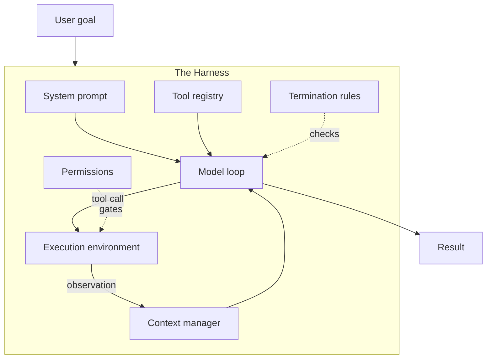

# Harness Fundamentals

> **TL;DR**: A model is not an agent. The *harness* — the loop that calls the model, the tool registry it can act through, the context it assembles each turn, the environment it runs in, and the permission and stop rules that keep it safe — is what turns raw next-token prediction into Claude Code or Cursor. Two products on the *same* model can feel worlds apart because the harness is different. If you're interviewing for agent work, you're being hired to build harnesses, not models.

**Prerequisites**: [Agent Fundamentals](../04-agents-and-orchestration/01-agent-fundamentals.md)
**Related**: [Context Management](02-context-management.md), [Coding-Agent Harnesses](04-coding-agent-harnesses.md), [Tool Use & Function Calling](../04-agents-and-orchestration/02-tool-use-and-function-calling.md)

---

## The Model Is Just One Component

Drop a frontier model into a chat box and you get a chatbot. Wrap it in a harness and you get an agent that edits your repo, runs your tests, and opens a PR. The delta is entirely engineering:



Everything in that box is your job. The model is a *hosted dependency* you don't control; the harness is the product you ship.

---

## The Model Loop

At its heart every agent is one loop:

```python
messages = [system_prompt, user_goal]
while True:
    response = model(messages, tools=registry)      # 1. think
    if response.stop_reason == "end_turn":
        return response.text                          # 4. done
    for call in response.tool_calls:                  # 2. act
        result = execute(call)                        # 3. observe
        messages.append(tool_result(call, result))
    messages.append(response)
```

Think → act → observe → repeat. That's it. This is the [ReAct](../04-agents-and-orchestration/01-agent-fundamentals.md) loop expressed as a harness. Everything else in this chapter is about making each line of that loop robust: *what* system prompt, *which* tools, *how much* context, *where* execution happens, *when* to stop.

---

## The Five Pieces

### 1. System Prompt

The harness's constitution — role, house rules, tool-use conventions, output format, safety boundaries. It's loaded once and rides every turn, so it's the most expensive real estate in the context window. Good harnesses keep it tight and push situational detail into tools and [skills](03-skills.md) instead of bloating the system prompt.

### 2. Tool Registry

The set of actions the model may take, each with a name, a description, and a JSON schema for its arguments (see [Tool Use & Function Calling](../04-agents-and-orchestration/02-tool-use-and-function-calling.md)). The registry is a **design surface, not a dump**: every extra tool is more tokens and one more thing the model can pick wrong. Curate it. Name and describe tools for the *model's* benefit — the description is a prompt.

### 3. Context Management

What actually goes into the model on each turn: the system prompt, relevant history, tool results, retrieved files. Because the context window is finite and every token costs latency and money, the harness must constantly decide what to include, summarize, or drop. This is the deepest topic in agent engineering — it gets its [own lesson](02-context-management.md).

### 4. Execution Environment

Where tool calls actually run — a shell, a filesystem, a browser, a sandbox. This is where an agent touches the real world, so it's where most of the risk lives. Options range from "run on the user's machine with their permissions" (powerful, dangerous) to "ephemeral container that's destroyed after the task" (safe, more setup). See [Coding-Agent Harnesses](04-coding-agent-harnesses.md).

### 5. Permissions & Termination

Two guardrails that keep the loop from becoming a liability:

- **Permissions** gate *what* the agent may do — which tools, which paths, which commands, and whether a human must approve first. Default to least privilege.
- **Termination** decides *when* to stop: task complete, step/token budget exhausted, repeated no-progress (loop detection), or a hard error. Without it, an agent burns budget forever or thrashes on an impossible task.

---

## Why Two Harnesses on the Same Model Diverge

Interviewers love this question. The same model can be a mediocre or an excellent coding agent depending on harness choices:

| Harness decision | Weak version | Strong version |
|---|---|---|
| Tools | One generic "run code" tool | Purpose-built read/edit/search/test/git tools |
| Context | Dump the whole repo | Retrieve only the files this step needs |
| Termination | Fixed N iterations | Stop on verified success; detect no-progress loops |
| Permissions | Unrestricted shell | Scoped paths + approval on destructive ops |
| Recovery | Crash on first tool error | Feed the error back and let the model retry |

None of that is a model upgrade. It's all harness.

---

## Interview Cheat Sheet

| They ask... | The crisp answer |
|---|---|
| "What's a harness?" | The loop + tools + context + environment + permissions/stop rules around a model that turn it into an agent. |
| "Why do Claude Code and a raw API feel so different on the same model?" | Different harnesses: tool design, context management, verification loops, permissions. |
| "What's the agent loop?" | think (model) → act (tool call) → observe (result) → repeat until a stop condition. |
| "Biggest risk surface?" | The execution environment — that's where the agent touches the real world; gate it with permissions and sandboxing. |
| "How do you stop runaway agents?" | Explicit termination: task-done signal, step/token budget, loop detection, hard-error abort. |

---

**Key takeaway**: The model predicts tokens; the harness makes it an agent. Master the five pieces — system prompt, tool registry, context management, execution environment, permissions/termination — and you can explain why any two agent products behave differently, and design one yourself.

Next: [Context Management](02-context-management.md) — the hardest and highest-leverage piece of the harness.
