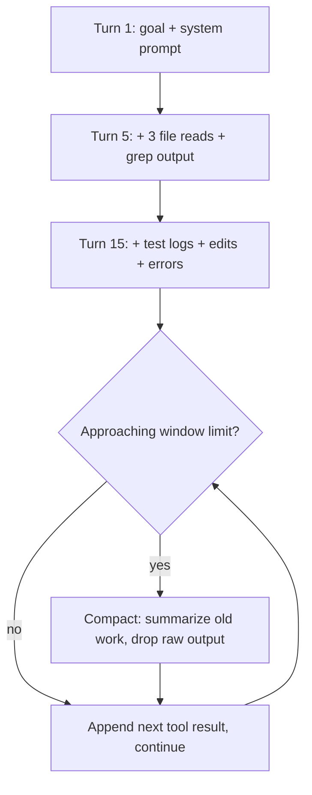

# Context Management

> **TL;DR**: A single prompt fits in the window; a 40-step agent run does not. Every tool call appends its output to a transcript that only grows, so the harness's core job is deciding, *turn after turn*, what to keep verbatim, what to summarize, and what to drop — before the window overflows mid-task. This is the same scarcity problem as [context engineering](../02-prompt-engineering/02-context-engineering.md), but seen across a long autonomous session instead of one request. Get it wrong and the agent forgets its own goal, re-reads the same file five times, or hits the limit and dies. Get it right and it stays coherent for hours.

**Prerequisites**: [Harness Fundamentals](01-harness-fundamentals.md), [Context Windows](../01-llm-foundations/04-context-windows.md)
**Related**: [Context Engineering](../02-prompt-engineering/02-context-engineering.md), [Memory & State](../04-agents-and-orchestration/10-memory-and-state.md), [Cost Optimization](../06-production-and-ops/07-cost-optimization.md)

---

## The Problem Is the Transcript, Not the Prompt

In a normal API call you assemble one context and send it. In an agent loop, the context is a *transcript that accumulates* — every model turn, every tool call, and every tool result gets appended and resent on the next turn. A coding agent that reads four files, runs the tests twice, and greps the repo has already spent tens of thousands of tokens, and it's only step six.



The window is fixed (the mechanics and the lost-in-the-middle effect are covered in [Context Windows](../01-llm-foundations/04-context-windows.md)); the transcript is not. Something has to give, and the harness is what decides.

---

## Keep, Summarize, or Drop

Every item in the transcript falls into one of three buckets on each turn. The art is classifying correctly.

| Bucket | What goes here | Why |
|---|---|---|
| **Keep verbatim** | The goal, persistent instructions, the last few turns, the current file/plan being worked on | The model reasons over exact text; recent state must be lossless |
| **Summarize** | Completed sub-tasks, long tool outputs already acted on, resolved errors | The *outcome* matters, the raw bytes don't — "ran tests, 2 failed in auth.py" replaces 300 lines of log |
| **Drop** | Superseded file contents, exploratory reads that led nowhere, duplicate observations | Pure noise now; keeping it just dilutes attention and burns tokens |

> **Gotcha**: The single most common failure is dropping the *goal*. As old turns get compacted, the original task description drifts out of the window and the agent starts optimizing for its most recent sub-task instead. Pin the goal — treat it as un-droppable, like the system prompt.

---

## Compaction: The Harness's Release Valve

**Compaction** is the operation that runs when the transcript approaches a threshold (say 70–80% of the usable window): the harness replaces a chunk of old turns with a compact summary and continues the *same* session. It is not the same as summarizing history in a chatbot — the agent has to keep working afterward, so the summary must preserve everything future steps depend on.

A good compaction summary captures:

- **The goal** and any hard constraints, restated verbatim.
- **What's been done** — decisions made, files changed, commands run and their outcomes.
- **What's left** — the open to-do items or plan.
- **Live state** — variable values, IDs, paths, error messages that later steps will reference.

```text
[COMPACTED — steps 1-22]
Goal: fix the flaky test in payments/test_refund.py so CI is green.
Done: located the race in RefundWorker.flush() (payments/worker.py:88);
      added a lock; ran suite -> test_refund passes, test_webhook now fails.
Open: test_webhook failure looks pre-existing (asserts on old field name);
      confirm, then fix or revert.
State: branch fix/refund-race; last run: 1 failed, 143 passed.
```

Everything before that block can be dropped. Note what survived: exact file paths, the branch name, the failing test. Lose those and the agent re-discovers them the expensive way.

> **Where compaction goes wrong**: summaries are lossy by definition. Over-compress and you erase the detail a later step needed (the exact error string, a config value); the agent then loops re-deriving it. Under-compress and you didn't buy enough headroom and you'll compact again in two turns. Reserve real budget for the summary and bias toward keeping concrete identifiers.

---

## Selective Retrieval and File Discovery

The best way to manage context is to never load junk in the first place. A weak harness dumps the whole repo (or top-k RAG chunks) into the window; a strong one *pulls on demand*. For a coding agent, "retrieval" is not a vector index — it's the filesystem, navigated with tools:

1. **Locate, don't load.** `grep`/glob for a symbol or string first. The result is a list of file:line hits — cheap. This is how the agent decides *what's worth reading* before spending tokens reading it.
2. **Read narrowly.** Open the specific file, ideally a line range, not the entire 2,000-line module. Read the function, not the file, when you can.
3. **Follow references outward.** From what you read, decide the next file. This mirrors how a human navigates an unfamiliar codebase — breadth-first search, not "memorize everything."
4. **Release when done.** Once a file's content has been used (edited, understood), it becomes a drop/summarize candidate — you don't need the raw source riding along for the rest of the run.

```text
grep "RefundWorker" -> 4 hits          # cheap: locate
read worker.py:80-120                    # narrow: only the method
edit worker.py (add lock)                # act
# worker.py source now summarizable: "added lock at flush()"
```

This is the harness analog of RAG's retrieve-then-read (see [RAG Fundamentals](../03-retrieval-and-rag/01-rag-fundamentals.md)), except the "index" is live tooling and every read is a deliberate token spend.

---

## Context Budgeting, With Numbers

Treat the window as a budget you allocate up front, then defend. The [Context Engineering](../02-prompt-engineering/02-context-engineering.md) lesson has the per-use-case allocation table; here's the *agent-run* version. Take an illustrative 200K-token window:

| Slice | Illustrative budget | Notes |
|---|---|---|
| System prompt | ~5K | Loaded once, rides every turn — keep it tight |
| Persistent instructions | ~3K | Project rules, conventions (see below) |
| Tool definitions | ~3K | Every tool's schema is always-on cost |
| Working set (files, recent turns) | ~120K | The live part you actively manage |
| Compaction summaries | ~15K | Accumulated history, compressed |
| Response + reasoning headroom | ~40K | **Reserve this** — if the window fills, the model can't answer |

The number that surprises people: the working set is the only slice you actively churn, and it's where compaction fights growth. Two rules of thumb:

- **Trigger compaction at ~70–80% of usable window**, not at 100%. You need room to *write* the summary and to keep generating.
- **Reserve response headroom explicitly.** An agent at 195K/200K has no room to produce a long edit or a final report — it'll truncate. Budget the output first, then fill the rest.

Token counts are approximate (~4 chars/token, worse for code and JSON); budget with margin and measure real usage rather than trusting the estimate.

> **Cost note**: A growing transcript resent every turn means later turns are far more expensive than early ones. Prompt caching (see [Cost Optimization](../06-production-and-ops/07-cost-optimization.md)) makes the stable prefix — system prompt, tool defs, persistent instructions — nearly free to resend, which is why you keep the volatile working set *after* the cached prefix, not interleaved with it.

---

## Persistent Instructions

Some context should ride *every* turn for the whole run: the coding conventions, the "always run the linter before committing," the project's directory layout. Harnesses formalize this as **persistent instructions** — a project file (Claude Code reads a `CLAUDE.md`; other tools use `.cursorrules`, `AGENTS.md`, etc.) that the harness pins near the top of context and never compacts away.

They differ from the system prompt in ownership and scope:

| | System prompt | Persistent instructions | Skill |
|---|---|---|---|
| Written by | Harness vendor | The user / project | User or vendor |
| Scope | Every session, every project | This project, every turn | Only when relevant |
| Loaded | Always | Always (this project) | On demand — see [Skills](03-skills.md) |

The design tension: persistent instructions are always-on tokens, so they compete with the working set. Keep them to durable, high-value rules (conventions, invariants, danger zones) and push situational, occasionally-needed procedures into [skills](03-skills.md), which load only when the task calls for them. That on-demand loading — progressive disclosure — is the subject of the next lesson.

---

## Interview Cheat Sheet

| They ask... | The crisp answer |
|---|---|
| "Why is context harder for an agent than a chatbot?" | The transcript grows every turn — tool calls and results accumulate — so you manage context continuously across the run, not once per request. |
| "What is compaction?" | When the transcript nears the window limit, the harness summarizes old turns into a compact block and continues the same session, preserving goal, state, and open work. |
| "What do you keep vs summarize vs drop?" | Keep the goal, persistent instructions, and recent/active state verbatim; summarize completed work and long outputs already acted on; drop superseded and dead-end content. |
| "How does a coding agent decide which files to read?" | Locate first (grep/glob → file:line hits), read narrowly (ranges, not whole files), follow references outward, release when done — never dump the repo. |
| "How do you budget the window?" | Allocate slices up front, reserve response headroom, trigger compaction at ~70–80% usable, and keep the stable prefix cacheable. |
| "Persistent instructions vs system prompt vs skills?" | System prompt = vendor, every session; persistent instructions = project, every turn; skills = loaded on demand only when relevant. |

---

**Key takeaway**: The agent's context is a transcript that only grows, so the harness must continuously decide what to keep, summarize, and drop, compact before it overflows, and pull files on demand rather than dumping them. Reserve response headroom, pin the goal, and keep the stable prefix cacheable. This is the highest-leverage piece of the whole harness.

Next: [Skills](03-skills.md) — packaged, on-demand know-how that keeps procedures out of the always-on budget.
