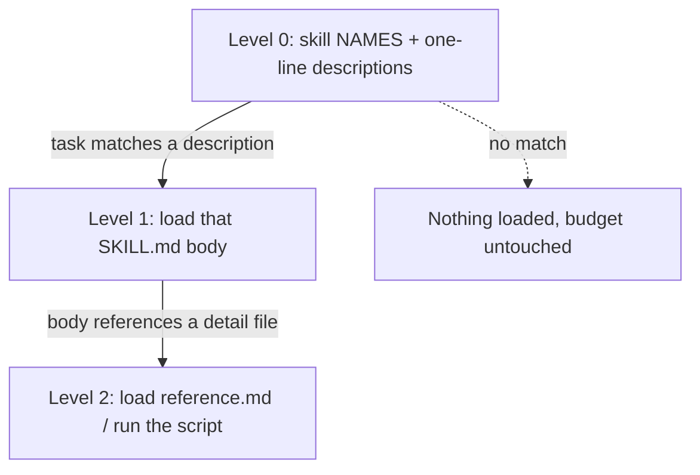

# Skills

> **TL;DR**: A **skill** is a packaged, reusable procedure — instructions plus optional scripts and reference files — that the agent loads *only when the task calls for it*. It's the answer to a real dilemma: you want the agent to know how to do fifty specialized things, but you can't afford fifty procedures' worth of tokens in every context. Skills solve it with **progressive disclosure** — the harness sees a one-line description of each skill cheaply, and pulls the full body into context only on a match. Think of them as on-demand playbooks that keep your always-on budget lean. Instructions, tools, and skills are three different things, and interviewers love to test whether you know the difference.

**Prerequisites**: [Harness Fundamentals](01-harness-fundamentals.md)
**Related**: [Context Management](02-context-management.md), [Tool Use & Function Calling](../04-agents-and-orchestration/02-tool-use-and-function-calling.md), [MCP Protocol](../04-agents-and-orchestration/03-mcp-protocol.md)

---

## What a Skill Is

A skill packages *how to do something* into a unit the agent can discover and load on demand. In the Claude Code model, a skill is a directory with a `SKILL.md` at its root: a metadata header (name, and a one-line description of *when* to use it) followed by the procedure in the body. Alongside it can sit supporting files — scripts the agent can run, templates, reference docs — that the body points to.

```text
skills/
  pdf-forms/
    SKILL.md            # name + "when to use" + the procedure
    fill_form.py        # a script the procedure invokes
    reference.md        # detail loaded only if the body needs it
```

```markdown
---
name: pdf-forms
description: Fill and flatten PDF forms. Use when the user needs to
  populate a fillable PDF or extract its field values.
---

# Filling PDF forms
1. Enumerate fields with `python fill_form.py --list <file>`.
2. Map the user's values to field names...
```

That header is the whole trick. It's short and cheap, so the harness can hold the descriptions of *many* skills at once. The expensive body loads only when the description matches the task at hand.

---

## Instructions vs Tools vs Skills

This is the distinction to nail. All three shape what an agent can do, but they operate at different layers, and conflating them is a classic interview stumble.

| | Instructions | Tools | Skills |
|---|---|---|---|
| **What it is** | Text the model reads | A function the model can call | A packaged procedure it loads |
| **Answers** | "How should I behave / what are the rules?" | "What action can I take?" | "How do I accomplish this whole task?" |
| **Mechanism** | Sits in context (system prompt, persistent instructions) | Schema in the tool registry; execution in the harness | Description always visible; body pulled in on demand |
| **When present** | Always-on | Always-on (schema costs tokens every turn) | Only when relevant |
| **Example** | "Always run the linter before committing" | `run_shell(cmd)`, `edit_file(path, diff)` | "Cut a release: bump version, tag, build, publish" |
| **Composed of** | — | — | Instructions + often *uses* tools |

The mental model: **a tool is a verb, an instruction is a rule, a skill is a recipe.** A skill typically *orchestrates tools* under the guidance of instructions — "cut a release" is a procedure that calls the shell tool, the git tool, and follows the project's rules. Skills sit one level up from tools.

> **Contrast with MCP**: [MCP](../04-agents-and-orchestration/03-mcp-protocol.md) is a *protocol for exposing tools and data* from external servers — it answers "what can I connect to." Skills are *authored know-how* that lives with your project and often drives those tools. They're complementary: MCP brings the tool, a skill teaches the workflow that uses it.

---

## Progressive Disclosure

The reason skills exist is a context-budget problem (see [Context Management](02-context-management.md)). Fifty full procedures might be 100K+ tokens. You cannot pay that on every turn — it would crowd out the working set and slow every call. Progressive disclosure loads context in layers, cheapest first:



| Level | What's in context | Token cost | When |
|---|---|---|---|
| 0 | Every skill's name + description | Tiny (a line each) | Always |
| 1 | The matched skill's full body | Moderate | On a description match |
| 2 | Supporting files / script output | As needed | When the body calls for it |

The payoff: an agent can *have* a hundred skills while paying, on a given task, for only the one or two it actually uses. This is the same keep-it-out-of-the-always-on-budget principle from context management, applied to capabilities instead of history.

> **Gotcha**: progressive disclosure lives or dies on the **description**. It's the only thing the model sees at Level 0, so it's effectively a routing prompt — it must say *when* to use the skill, not just what it is. "PDF utilities" won't fire; "Use when the user needs to fill a fillable PDF form" will. A brilliant skill body with a vague description is dead weight.

---

## Discovery and Loading

How does the right skill get pulled in at the right moment?

1. **Registration.** At startup the harness scans skill directories and reads just the headers, building a cheap catalog of `name → description`. This catalog rides in context (or is matched against) but the bodies stay on disk.
2. **Matching.** As the task unfolds, the model (or a lightweight retrieval step) matches the current need against those descriptions. Good descriptions make this reliable; overlapping or vague ones cause misfires.
3. **Loading.** On a match, the harness injects the full `SKILL.md` body into context. Now the agent follows the procedure — often running the skill's bundled scripts through its normal tools.
4. **Release.** When the sub-task is done, the body becomes a summarize/drop candidate, freeing the budget again.

The loading step is deliberately just-in-time. It's the difference between "the agent *has access to* a hundred skills" (cheap, always true) and "the agent *is currently reading* one" (expensive, only when needed).

---

## Composition and Domain Skills

Skills compose. A high-level skill can invoke lower-level ones, the way functions call functions — "onboard a new microservice" might chain a "scaffold repo" skill, a "wire up CI" skill, and a "register in service catalog" skill. Keep each one focused and single-purpose; compose them rather than writing one monolithic mega-skill, for the same reasons you keep functions small — reuse, testability, and clean progressive disclosure.

The real leverage is **domain-specific** skills — the ones that encode *your* environment's hard-won knowledge that no base model could know:

- "Deploy to our staging cluster" (the exact kubectl context, the approval step, the smoke test).
- "Add a feature flag" (our flag service, our naming convention, the rollout checklist).
- "Generate a compliance report in the format legal requires."

These turn a general agent into one that knows *your* shop. They're also where skills beat cramming everything into the system prompt: this knowledge is occasional, so it should be loaded occasionally, not carried on every turn.

> **Design rule**: if a piece of knowledge is needed on *most* turns, it belongs in [persistent instructions](02-context-management.md). If it's needed *occasionally* and has a procedure, make it a skill. If it's a single *action*, make it a tool. Route each capability to the cheapest layer that fits.

---

## Anti-Patterns

Skills are easy to build and easy to build badly. The failure modes cluster:

| Anti-pattern | Why it hurts | Fix |
|---|---|---|
| **Vague description** | Never fires at Level 0, or fires on the wrong task | Write the description as "use *when* …"; make it specific and distinct from neighbors |
| **Overlapping skills** | The model can't tell two similar descriptions apart and picks wrong | Merge them, or sharpen each description to a disjoint trigger |
| **The mega-skill** | A 2,000-line body that dumps a huge payload the moment it loads, defeating progressive disclosure | Split into a thin body that *points to* detail files loaded at Level 2 |
| **Skill sprawl** | Hundreds of half-maintained skills bloat the Level-0 catalog and rot | Curate like a tool registry; delete dead skills; treat the catalog as a design surface |
| **Skill that should be a tool** | Wrapping a single deterministic action in a procedure adds a loading hop for nothing | If it's one action, expose it as a tool instead |

> **Rule of thumb**: a skill body should be mostly *judgment and sequencing* — the stuff a model genuinely benefits from reading. Bulk reference data and deterministic steps belong in Level-2 files and scripts, not inline in the body.

---

## Interview Cheat Sheet

| They ask... | The crisp answer |
|---|---|
| "What's a skill?" | A packaged, reusable procedure (instructions + optional scripts/refs) the agent loads on demand when the task matches its description. |
| "Instructions vs tools vs skills?" | Instruction = a rule (always-on text); tool = an action the model can call (always-on schema); skill = a recipe loaded only when relevant. |
| "What is progressive disclosure and why does it matter?" | Load context in layers — names/descriptions always, bodies on match, detail files as needed — so an agent can have many skills but pay for only the ones it uses. |
| "How does the harness pick the right skill?" | It matches the task against each skill's one-line 'when to use' description; the description is effectively a routing prompt, so it must be specific. |
| "Skills vs MCP?" | MCP is a protocol that exposes tools/data from external servers; skills are authored procedures that often drive those tools. Complementary, not competing. |
| "When would you build a skill vs extend the system prompt?" | Occasional, procedural knowledge → skill (keeps it out of the always-on budget); always-needed rules → instructions; single action → tool. |

---

**Key takeaway**: Skills are on-demand playbooks. They exist to give an agent broad, domain-specific know-how without paying for all of it on every turn — progressive disclosure keeps the descriptions cheap and always visible while the bodies load only on a match. Route each capability to its cheapest layer: rule → instruction, action → tool, recipe → skill.

Next: [Coding-Agent Harnesses](04-coding-agent-harnesses.md) — the concrete tools a real coding agent needs.
