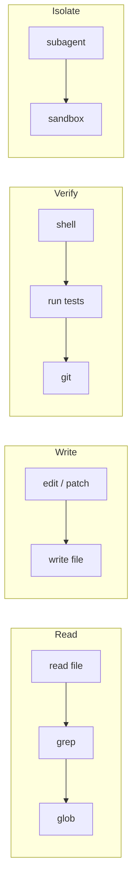
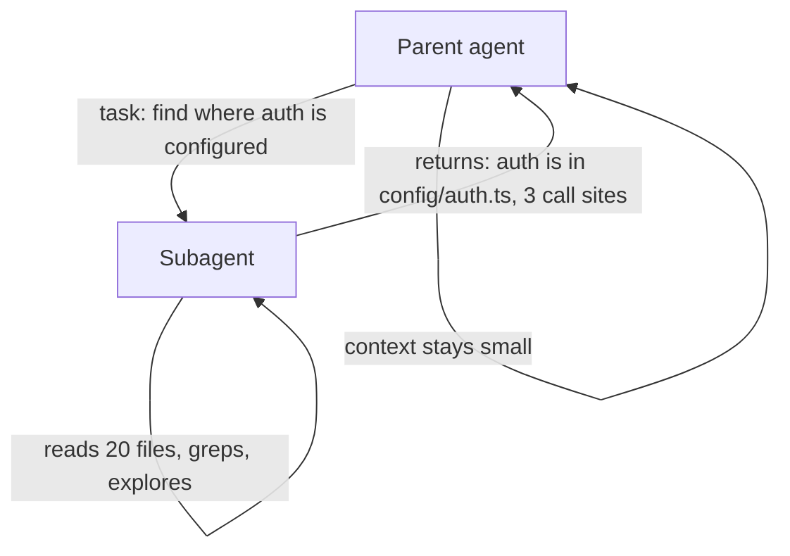

# Coding-Agent Harnesses

> **TL;DR**: A coding agent is only as good as the tools its harness hands the model. The winning designs are boringly specific: a `read` tool that returns line numbers, a `grep`/`glob` pair for search, a *structured edit* tool that patches a few lines instead of rewriting the file, and first-class `test` and `git` tools. Generic "run this shell command" works, but purpose-built tools are cheaper in tokens, easier for the model to use correctly, and safer to gate. Claude Code, Cursor, and Codex converge on nearly the same tool surface — that convergence is the lesson.

**Prerequisites**: [Harness Fundamentals](01-harness-fundamentals.md), [Tool Use & Function Calling](../04-agents-and-orchestration/02-tool-use-and-function-calling.md)
**Related**: [Execution](05-execution.md), [Reliability](06-reliability.md), [Context Management](02-context-management.md)

---

## The Coding Tool Surface

Ask five coding agents what tools they expose and you get roughly the same list. That's not copying — it's convergent evolution toward the actions a model needs to change a repo safely:



The rest of this lesson walks the surface tool by tool, using Claude Code, Cursor, and Codex as concrete points of reference. Keep one question in mind: *why is this its own tool instead of a shell command?* The answer is almost always tokens, safety, or reliability.

---

## Filesystem Tools: Read / Write / Edit

Three distinct verbs, not one "file I/O" tool.

- **Read** returns file contents *with line numbers* and usually supports an offset/limit so the model can page through a large file instead of blowing its context on one 5,000-line module. Line numbers matter: they give the edit tool an unambiguous anchor and let the model cite locations.
- **Write** creates or fully replaces a file. Cheap for new files, dangerous for existing ones — a full rewrite risks silently dropping code the model didn't bother to reproduce.
- **Edit** is the workhorse; see the next section.

> **Gotcha**: Most harnesses require that a file be **read before it's edited or written**. This isn't bureaucracy — it forces the model's context to contain the current bytes, so the edit is anchored to reality rather than to a hallucinated version of the file. It also catches the "file changed under me" race.

---

## Patch / Edit Tools: Why Structured Edits Beat "Rewrite the File"

This is the single highest-leverage tool decision in a coding harness. The naive design is "here's the new file, write all of it." The good design is a **structured edit**: the model provides an `old_string` and a `new_string`, and the harness does an exact find-and-replace.

| | Full-file rewrite | Structured edit (find/replace) |
|---|---|---|
| Output tokens | Entire file, every change | Only the changed region |
| Risk | Model omits or mangles untouched code | Untouched code is physically untouchable |
| Failure mode | Silent corruption | Loud: "old_string not found" or "not unique" |
| Diff review | Noisy, whole-file | Minimal, reviewable |
| Cost/latency | Scales with file size | Scales with edit size |

The failure mode is the hidden win. If the `old_string` doesn't match exactly, the edit *fails loudly* and the harness feeds that error back — a recoverable event (see [Reliability](06-reliability.md)). A botched full-file rewrite fails *silently*: the file is now wrong and nothing complained.

```python
# Structured edit: surgical, verifiable, cheap
edit(path="app.py",
     old_string="def handler(req):\n    return req.body",
     new_string="def handler(req):\n    validate(req)\n    return req.body")
# Harness enforces old_string is unique; else it errors and the model retries.
```

Cursor leans on a fast "apply" model that turns a terse edit sketch into a real diff; Claude Code and Codex expose explicit string-replacement edits. All three are variations on the same principle: **make the model emit the delta, not the document.**

---

## Shell Execution

A general `bash`/shell tool is the escape hatch that covers everything the purpose-built tools don't: install a dependency, run a linter, start a build, `curl` an endpoint. You keep it because you can't anticipate every command — but you don't route *everything* through it.

Why not shell-only? A dedicated tool carries structure the harness can exploit: it can parse the output, enforce a timeout, scope the working directory, and gate the specific action for permissions. `run_tests()` can summarize pass/fail; `bash("pytest")` just returns a wall of text. Design principle: **specific tools for the common, well-understood actions; a shell for the long tail.**

> **Gotcha**: Long-running or backgrounded shell commands (dev servers, watchers) need explicit handling — a timeout, a background mode, or a way to stream and later kill the process — or the agent loop hangs waiting for a command that never returns.

---

## Search: Grep and Glob

Search is how an agent navigates a repo it has never fully read. Two complementary tools:

- **Glob** finds files by *name/path pattern* — `src/**/*.ts`, `**/test_*.py`. Fast structural discovery.
- **Grep** finds files by *content* — a regex across the tree, ideally backed by something like ripgrep for speed. This is the agent's primary tool for "where is `AuthToken` defined/used?"

These matter more than they look. They are the harness's answer to *selective retrieval* (see [Context Management](02-context-management.md)): instead of stuffing the whole repo into context, the model searches, reads only the hits, and keeps its window lean. A coding agent without good search either drowns in context or flies blind.

---

## Tests & Git

These two deserve to be first-class, not buried in the shell.

**Tests** are the verification substrate. When running tests is a named tool (or a strongly-encouraged shell pattern), the harness can make "did the change pass?" a structured signal that drives the loop — the foundation of test-driven agents in [Reliability](06-reliability.md).

**Git** gives the agent a memory and an undo:

- `git diff` / `git status` let the model see exactly what it has changed — cheaper and more accurate than re-reading every file.
- Commits create **checkpoints** the agent (or user) can roll back to (see [Execution](05-execution.md)).
- `git` is also the natural output boundary: the agent's deliverable is a branch, a diff, or a PR — reviewable by a human before anything merges.

> **Gotcha**: Give the agent `git` but gate the destructive edges. `git reset --hard`, force-push, and `git clean` can vaporize uncommitted work. Most harnesses either require approval for these or forbid them outright.

---

## Browser

Some coding tasks can't be verified from the terminal: a UI bug, a broken layout, a flow that only fails in a real page. A **browser tool** (drive a headless browser, click, read the DOM, screenshot) closes that loop. It's the same computer-use capability covered in [Browser & Computer Use](../04-agents-and-orchestration/12-browser-and-computer-use.md), applied to a coding harness so the agent can *see* the app it just changed.

Treat it as heavy machinery: it's slow, token-hungry (screenshots and DOM dumps are large), and a wide risk surface. Bring it in for front-end verification and web research, not as a default tool on every task.

---

## Subagents (as a Tool Shape)

A **subagent** is a tool whose implementation is *another agent loop*. The parent calls it with a task string; the child runs its own turns with its own context window and returns a single summarized result.

The reason this belongs in the tool discussion is **context isolation**. The child can read twenty files, run searches, and burn thousands of tokens exploring — and the parent only ever sees the child's short final report. That makes the subagent a *compaction primitive*: expensive, messy work happens off to the side and the parent's context stays clean.



Claude Code's `Task`/subagent tool and Cursor's background agents are instances of this. Here we care about the *tool shape*; the *execution strategy* — when to fan out, run in parallel, and join — is the subject of [Execution](05-execution.md).

---

## Sandboxing (the Mechanism)

Every tool above touches the real machine. Sandboxing is *where* that happens and what it can reach. This section is about **mechanism**; the *policy* layer (allowlists, approval prompts) lives in [Reliability](06-reliability.md).

| Model | Isolation | Blast radius | Used by |
|---|---|---|---|
| Run on host, user's perms | None | Your whole machine | Local CLI agents, default mode |
| Host + permission gating | Approval prompts | Scoped by policy, not walls | Claude Code local |
| Container per session | Process/FS namespace | The container | Cloud coding agents |
| Ephemeral microVM | Hardware-level | Destroyed after task | Codex cloud, hosted sandboxes |

The dimensions to reason about:

- **Filesystem scope** — can the agent only touch the project directory, or the whole disk?
- **Network egress** — open, blocked, or allowlisted? Blocking egress is the cheapest defense against exfiltration and against a compromised dependency phoning home.
- **Lifecycle** — persistent workspace vs. ephemeral container torn down after the run (no lingering state, no cross-task contamination).

> **Gotcha**: There's a real tension. A tighter sandbox (no network, ephemeral FS) is safer but breaks tasks that legitimately need to `pip install` or hit an API. The harness's job is to pick the *loosest sandbox that still contains the blast radius* for the task at hand — and to escalate to a human when a task wants to step outside it.

---

## Interview Cheat Sheet

| They ask... | The crisp answer |
|---|---|
| "Why a structured edit tool instead of rewriting the file?" | Fewer output tokens, untouched code can't be corrupted, and mismatches fail *loudly* so the agent can retry — a rewrite fails silently. |
| "Why separate grep/glob tools if you have a shell?" | Search is how the agent does selective retrieval; dedicated, fast tools keep context lean and are safe to expose without full shell. |
| "Why require reading a file before editing it?" | Forces the current bytes into context so the edit anchors to reality, and catches concurrent modification. |
| "What makes tests and git first-class tools?" | Tests are the verification signal that drives the loop; git gives checkpoints, a diff-based memory, and a reviewable output boundary. |
| "Subagent — what problem does it solve?" | Context isolation: messy exploration happens in a child window; the parent only sees a short report. |
| "How do you sandbox a coding agent?" | Pick the loosest isolation that still contains the blast radius — scope the filesystem, gate/allowlist network egress, prefer ephemeral lifecycles, escalate to a human to step outside. |

---

**Key takeaway**: Coding harnesses converge on the same tool surface — read/write/edit, shell, grep/glob, tests, git, browser, subagents — because those are the verbs of safely changing a repo. The craft is in the *shape* of each tool: structured edits over rewrites, dedicated search over shell, first-class verification, and a sandbox sized to the blast radius.

Next: [Execution](05-execution.md) — how the harness plans and runs a big multi-step task without losing state.
