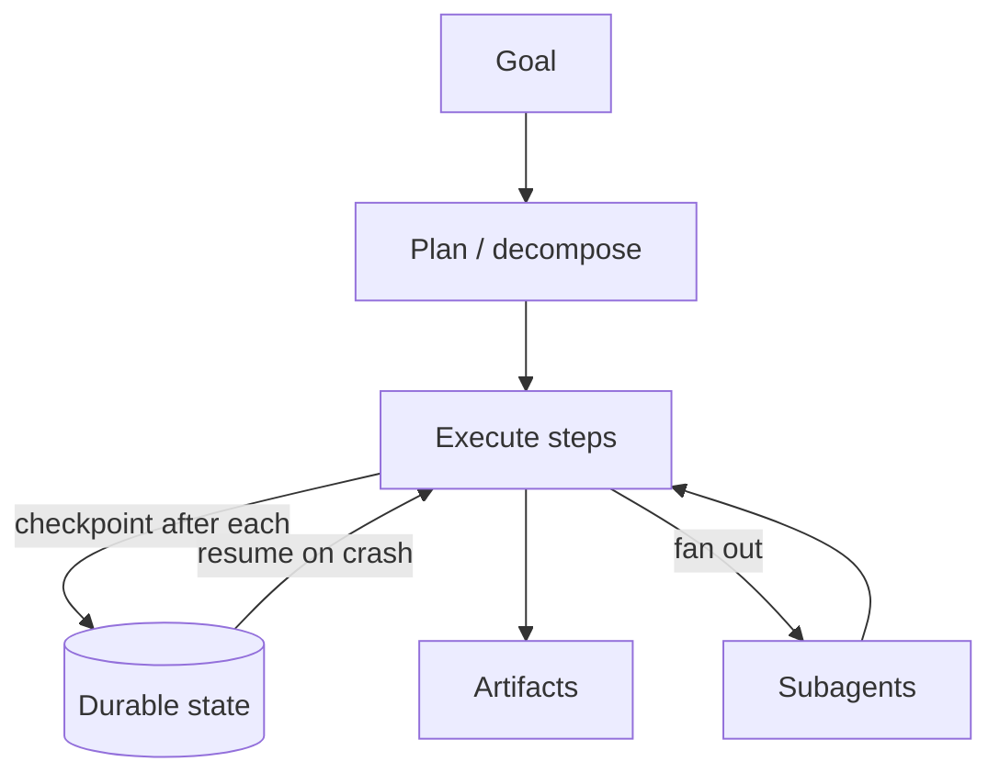

# Execution

> **TL;DR**: A one-shot answer is easy; a forty-step refactor that survives a crash is engineering. The execution layer of a harness turns a fuzzy goal into an ordered plan, decides what to run in parallel, checkpoints progress so state isn't lost, and produces durable artifacts. The mental model to steal: a coding agent is a *durable workflow engine* whose steps happen to be model calls — the same problem LangGraph solves for graphs, applied to an open-ended loop.

**Prerequisites**: [Harness Fundamentals](01-harness-fundamentals.md), [Coding-Agent Harnesses](04-coding-agent-harnesses.md)
**Related**: [Reliability](06-reliability.md), [LangGraph Deep Dive](../04-agents-and-orchestration/05-langgraph-deep-dive.md), [Multi-Agent Systems](../04-agents-and-orchestration/09-multi-agent-systems.md)

---

## Why Execution Is Its Own Problem

A single model call has no memory of the last one. String forty of them together into a real task — "migrate this service off the deprecated API" — and everything hard is about *state across calls*: what's the plan, which steps are done, what did we learn, and can we survive an interruption. The model doesn't manage any of that. The harness does.



---

## Planning & Task Decomposition

Big tasks fail when the agent dives into step one without a map. The fix is an explicit **plan-then-execute** phase: before touching code, the agent writes an ordered list of steps and keeps it as a living to-do list.

Why it works:

- **It's a scaffold for the model's own reasoning.** A written plan keeps a long task coherent instead of drifting.
- **It's a progress ledger.** Marking steps done/in-progress is cheap state that tells the agent (and the user) exactly where things stand — and what to resume.
- **It's a review point.** A human can approve or correct the plan *before* the agent spends an hour executing the wrong one.

This is the practical face of decomposition: turn one intractable goal into a sequence of verifiable steps. Claude Code's todo list and Codex's plan mode are both this pattern — a persisted, updatable list the agent maintains as it works.

> **Gotcha**: Plans must be *revisable*, not frozen. Step 3 often reveals that steps 4–7 were wrong. A harness that can't re-plan mid-task will march an obsolete plan straight off a cliff. Treat the plan as mutable state, re-derived when reality contradicts it.

---

## Parallelization & Subagents

[Coding-Agent Harnesses](04-coding-agent-harnesses.md) introduced the subagent as a *tool shape* (context isolation). Here it's an *execution strategy*: run independent work concurrently.

The rule is dependency-driven. **Fan out only when subtasks are independent; keep sequential anything where step N needs step N-1's output.**

| Pattern | When it pays | Watch out for |
|---|---|---|
| Sequential | Steps depend on each other | The default — don't parallelize a chain |
| Parallel fan-out | Independent subtasks (search 5 modules, review 3 files) | Merge cost; no shared context between children |
| Orchestrator + workers | A lead plans and delegates; workers execute isolated pieces | Coordination overhead; must join results coherently |

The payoff is twofold: **latency** (three searches at once beat three in a row) and **context economy** (each child burns its own window and returns a summary). The cost is coordination — the parent must *join* the results, and children can't see each other's work. This is the harness-level version of the [multi-agent](../04-agents-and-orchestration/09-multi-agent-systems.md) orchestrator/worker pattern: same trade-offs, applied inside one coding session.

> **Gotcha**: Parallel writers to the same files collide. Fan out *reads and analysis* freely; serialize *edits*, or give each worker a disjoint slice of the tree.

---

## Checkpoints

A checkpoint is a saved point you can return to. Two flavors, both essential:

- **Semantic checkpoints** — `git` commits after each coherent step. They give the agent a diff-based memory and give the user a clean rollback ("undo the last change, keep the rest").
- **Session checkpoints** — the harness persists the message history, the to-do list, and tool state so the run can be *resumed* rather than restarted.

The design question is *granularity*: checkpoint too rarely and a crash loses an hour of work; too often and you drown in bookkeeping. A good default is to checkpoint at every completed plan step — the same boundary that already means something to the user.

---

## Long-Running Tasks & Resumability

This is where the harness earns its keep. A task that runs for an hour *will* hit an interruption — a crash, a rate limit, a machine reboot, a human walking away. Resumability means that interruption costs minutes, not the whole run.

The pattern is **durable execution**, and it's exactly what [LangGraph](../04-agents-and-orchestration/05-langgraph-deep-dive.md) formalizes with checkpointers and a persisted graph state: after every step, write state to durable storage; on restart, load the last checkpoint and continue. A coding harness is the same idea over an open-ended loop instead of a fixed graph.

```python
# Durable loop: every step is recoverable
state = load_checkpoint(session_id) or init_state(goal)
while not state.done:
    step = next_step(state)                 # plan-driven
    result = execute(step)                  # model call + tools
    state = state.apply(result)
    save_checkpoint(session_id, state)      # <-- survive a crash here
```

What must be durable: the plan and its progress, the conversation/context (often compacted — see [Context Management](02-context-management.md)), and any external side effects already committed (so you don't redo them). The hard part is **idempotency** — on resume, replaying a step that already ran a migration or opened a PR must not do it twice. Track which side effects have committed and skip them on replay.

> **Gotcha**: Context compaction and resumability interact. If you summarize away history to fit the window, your checkpoint must store enough to reconstruct what the summary dropped, or a resumed agent "forgets" decisions it already made.

---

### What Must Survive a Restart

Not all state is equal. A useful checklist of what a checkpoint has to hold:

| State | Why it must persist | If you drop it |
|---|---|---|
| Plan + step progress | The map and the "you are here" | Agent re-plans from scratch or repeats done steps |
| Context / message history | The reasoning so far | Agent forgets decisions and prior findings |
| Committed side effects | What already touched the world | Duplicate PRs, double migrations |
| Working artifacts (files, branch) | The actual output | Lost work |

Anything *not* on this list — transient tool output, scratch reasoning — can be safely recomputed or dropped, which is what makes compaction and resumability compatible.

---

## Artifacts

Artifacts are the **durable outputs** an agent produces that outlive any single turn: files on disk, a git branch or PR, a generated report, a to-do list, a built binary. They matter to execution for two reasons.

- **They *are* the state.** The filesystem and git history are the most reliable memory a coding agent has. Reading the current diff beats trusting the conversation's account of what changed.
- **They're the deliverable boundary.** The user consumes the artifact (the PR, the file), not the transcript. Designing the harness around clean artifacts — a reviewable branch, a coherent set of files — is what makes the output trustworthy.

Prefer artifacts the user's existing tools already understand. A git branch is reviewable in any code host; a Markdown report opens anywhere. The harness's job is to route work into those durable, inspectable forms rather than leaving results trapped in a chat log.

---

## Interview Cheat Sheet

| They ask... | The crisp answer |
|---|---|
| "How does an agent handle a big multi-step task?" | Plan-then-execute: write an ordered, revisable to-do list, execute step by step, checkpoint after each, re-plan when reality contradicts the plan. |
| "When do you parallelize with subagents?" | Only for independent subtasks — for latency and context economy. Serialize anything with dependencies, and never let parallel workers edit the same files. |
| "What makes a long-running agent resumable?" | Durable execution: persist plan, progress, and context after every step; on restart load the last checkpoint. The hard part is idempotency on replay. |
| "How is this like LangGraph?" | Same durable-execution idea — checkpoint state after each step, resume from it — but over an open-ended loop instead of a fixed graph. |
| "What are artifacts and why care?" | Durable outputs (files, branches, PRs, reports) that outlive a turn. They double as the agent's most reliable state and as the user's actual deliverable. |

---

**Key takeaway**: Treat a coding agent as a durable workflow engine whose steps are model calls. Plan explicitly and revise the plan, parallelize only what's independent, checkpoint at every step, make replay idempotent, and route results into durable artifacts. Do that and an hour-long task survives a crash instead of starting over.

Next: [Reliability](06-reliability.md) — the verification loops and recovery mechanics that make those steps trustworthy.
