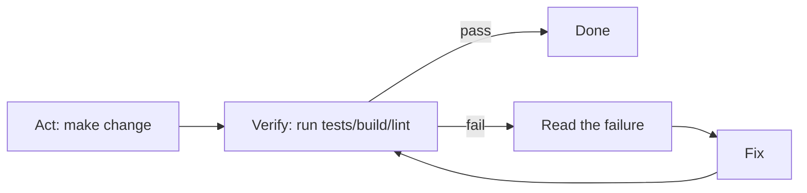

# Reliability

> **TL;DR**: The single biggest quality lever in an agent harness is not a better model — it's a **verification loop**: the agent checks its own work and fixes what fails. Run the tests, read the error, feed it back, retry. Everything else in this lesson — test-driven agents, self-correction, permission boundaries, loop detection, token budgets, error recovery — exists to make that loop tight, safe, and terminating. An agent that can't tell whether it succeeded is a random number generator with good grammar.

**Prerequisites**: [Harness Fundamentals](01-harness-fundamentals.md), [Execution](05-execution.md)
**Related**: [Coding-Agent Harnesses](04-coding-agent-harnesses.md), [Agent & E2E Eval](../05-evaluation/04-agent-and-e2e-eval.md), [Prompt Security](../02-prompt-engineering/05-prompt-security.md)

---

## Verification Loops: The Biggest Lever

A model generates plausible code. Plausible is not correct. The gap between "looks right" and "is right" is closed by a verification loop:



The insight interviewers want: **give the agent a ground-truth signal it can't argue with.** Tests, a compiler, a type checker, a linter, a failing assertion — each is an oracle the model can't sweet-talk. A harness that runs the tests after every change and loops on failure will out-perform a smarter model with no verification, because it converts "I think this is done" into "the suite is green."

The corollary: the quality of a coding agent is capped by the quality of its verification signal. No tests, no build step, no oracle → the agent is guessing, and so are you.

---

## Test-Driven Agents

Push verification to its logical end: write the test *first*. Given a bug or feature, the agent (or the human) writes a failing test that encodes "done," then edits code until it passes.

Why this is more than a style preference:

- **It pins down the target.** A red test is an unambiguous success criterion — no interpreting whether the vibe of the output is correct.
- **It bounds the loop.** "Iterate until this test passes" is a clean termination condition; "iterate until it looks good" never terminates.
- **It resists reward-hacking the wrong goal.** The test constrains what "fixed" can mean, so the agent can't declare victory by changing unrelated behavior.

> **Gotcha**: Watch for the agent that makes the test pass by *weakening the test* or hard-coding the expected value. Verification is only as honest as the oracle. Keep the test authored or reviewed by a human, and treat "agent edited the test to make it pass" as a red flag to inspect.

---

## Self-Correction

Self-correction is the *fix* half of the loop: when verification fails, the agent revises rather than plows ahead. The mechanism is almost embarrassingly simple — **put the failure in the context and ask again** — but the design decisions around it matter:

- **Feed the *actual* error**, not a paraphrase. The full stack trace, the failing assertion, the compiler message. Specifics are what let the model localize the fix.
- **Preserve what worked.** Re-running from scratch throws away correct progress. Correct the failing step; keep the rest.
- **Escalate strategy on repeated failure.** Same fix twice → change approach: add logging, read more of the file, question the assumption, or ask the human. More on that under loop detection.

Self-correction is why feeding errors back (below) is the highest-ROI recovery mechanic in the whole harness.

---

## Permission Boundaries (the Policy Layer)

[Coding-Agent Harnesses](04-coding-agent-harnesses.md) covered sandboxing as *mechanism* — the walls. Permission boundaries are the *policy* inside those walls: which specific actions are allowed, which need a human's yes, which are forbidden.

A workable model has three tiers:

| Tier | Examples | Rule |
|---|---|---|
| Auto-allow | read files, grep, run tests, `git diff` | Safe, reversible, read-mostly — no prompt |
| Ask first | `git push`, `rm`, network calls, package installs, edits outside the workspace | Reversible-but-consequential — human approval |
| Never | `git reset --hard`, credential access, `curl \| sh`, force-push | Destructive or exfiltration-shaped — blocked |

Two principles keep this honest. **Least privilege**: default to the tightest tier and widen deliberately. **Approval as a first-class harness feature**: pausing to ask a human isn't a failure of autonomy, it's the design — allowlists and per-command prompts (Claude Code's permission model, Codex's approval modes) are how a powerful agent stays trustworthy.

> **Gotcha**: Permission boundaries are also your defense against [prompt injection](../02-prompt-engineering/05-prompt-security.md). If a malicious file or web page convinces the agent to exfiltrate secrets or run a destructive command, the boundary — not the model's judgment — is what stops it. Never let untrusted input widen the agent's privileges.

---

## Loop Detection

Agents get stuck in loops: the same failing edit, the same command, two files ping-ponging the same change. Left alone, that burns budget and money to no effect. The harness needs to *notice*:

- **Repetition signals** — identical or near-identical tool calls, the same error N times, a diff that reverts a previous diff, no change in the verification signal across several turns.
- **Responses** — break the pattern: force a different action, inject a "you've tried this; try another approach" nudge, escalate to a human, or terminate with a clear "stuck" report rather than pretending success.

The deeper principle: **no-progress is a stop condition.** A harness that only stops on success or a step cap will happily thrash for fifty turns. Detecting that progress has stalled is what separates a robust loop from a runaway.

---

## Token Budgets

A token budget is a **termination condition**, not a packing strategy — the context-window *packing* side lives in [Context Management](02-context-management.md). Here the budget is a hard limit on how much a task may spend before the harness stops.

Why it's non-negotiable: an agent with no budget and a subtly impossible task will loop until it exhausts the context window or your wallet. The budget caps blast radius on cost and latency the same way permissions cap it on safety.

Practical shape:

- Track cumulative tokens (and/or step count) across the whole run, not per call.
- On approaching the limit, degrade gracefully — summarize state, produce a partial result, hand back to the human — rather than dying mid-edit.
- Surface spend so a human can extend the budget for a genuinely large task instead of the agent silently quitting.

---

## Error Recovery

The mechanic that ties it all together, and the highest-leverage line in the whole harness: **when a tool call fails, feed the error back and let the model retry** — don't crash.

```python
try:
    result = execute(call)
except ToolError as e:
    result = f"ERROR: {e}\nFix the cause and try again."   # <-- recover, don't die
messages.append(tool_result(call, result))                 # model sees the error next turn
```

A brittle harness treats the first `pytest` failure, missing file, or bad `old_string` as fatal. A robust one treats every error as *information the model can act on*. Models are remarkably good at fixing a problem once they can see the exact error — which is why this one design choice often matters more than a model upgrade.

Layer it:

- **Retry with the error in context** — the default; handles most transient and logic failures.
- **Bounded retries** — cap attempts so a permanently failing call doesn't become an infinite loop (this is where loop detection and token budgets backstop you).
- **Graceful degradation** — after the cap, stop and report honestly: what was attempted, what failed, what state things are in. A truthful "I couldn't do X because Y" beats a confident wrong answer every time.

---

## Interview Cheat Sheet

| They ask... | The crisp answer |
|---|---|
| "Biggest lever for agent quality?" | A verification loop — give the agent a ground-truth oracle (tests/compiler/linter) and make it fix what fails. Beats a smarter model with no verification. |
| "How does an agent self-correct?" | Put the *actual* error back in context, fix the failing step while preserving what worked, and escalate strategy on repeated failure. |
| "Why test-driven agents?" | A failing test is an unambiguous success criterion and a clean termination condition — 'until this passes' terminates, 'until it looks good' doesn't. |
| "How do you keep it safe?" | Tiered permissions (auto-allow / ask-first / never) under least privilege, with human approval as a first-class feature and a defense against prompt injection. |
| "How do you stop a runaway agent?" | Treat no-progress as a stop condition (loop detection), cap spend with a token/step budget, and degrade gracefully instead of thrashing. |
| "What do you do on a tool error?" | Feed the error back and retry — bounded. Errors are information; crashing on the first one throws away the agent's best skill. |

---

**Key takeaway**: Reliability is engineered, not prompted. Wrap every change in a verification loop against a real oracle, feed failures back for self-correction, fence actions with tiered permissions, detect no-progress and cap the budget so the loop terminates, and recover from errors instead of crashing. That stack turns a plausible-code generator into an agent you can trust with your repo.

Next: [Real Systems](07-real-systems.md) — how Claude Code, Codex, and the major frameworks make these choices in practice.
