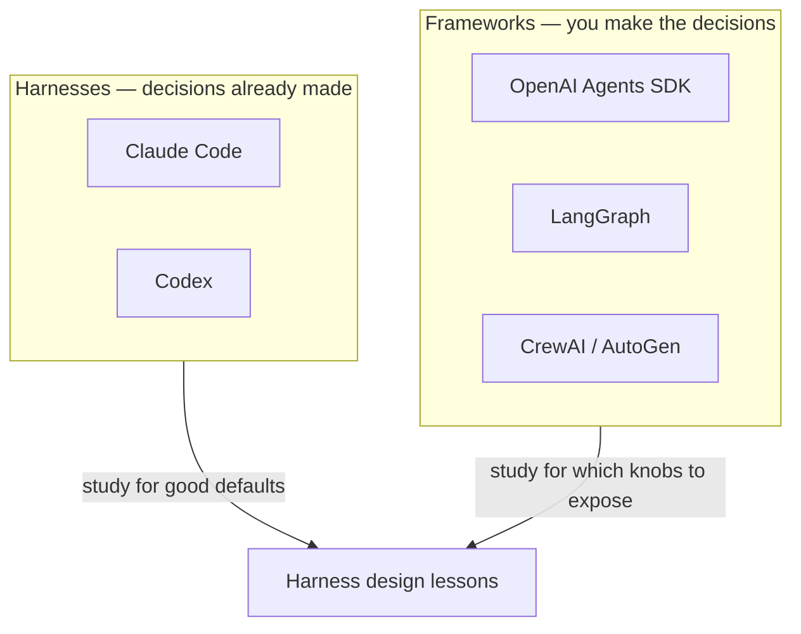

# Study Real Systems

> **TL;DR**: The fastest way to learn harness design is to reverse-engineer the systems that shipped one. Claude Code and Codex are *opinionated coding harnesses* — a curated tool surface, aggressive verification, tiered permissions. The OpenAI Agents SDK, LangGraph, and CrewAI/AutoGen are *frameworks* — they hand you the loop and orchestration primitives and let you build the harness. The interview move is to name each system's choices on four axes — tool design, context strategy, permissions, execution model — and say what you'd steal.

**Prerequisites**: [Harness Fundamentals](01-harness-fundamentals.md), [Coding-Agent Harnesses](04-coding-agent-harnesses.md), [Execution](05-execution.md), [Reliability](06-reliability.md)
**Related**: [LangGraph Deep Dive](../04-agents-and-orchestration/05-langgraph-deep-dive.md), [Multi-Agent Systems](../04-agents-and-orchestration/09-multi-agent-systems.md), [Agentic Patterns](../04-agents-and-orchestration/11-agentic-patterns.md)

---

## Two Categories, Not One

Don't compare these systems on a single scale — they answer different questions.

- **Harnesses** (Claude Code, Codex) are finished products. Every one of the five pieces from [Harness Fundamentals](01-harness-fundamentals.md) is already decided for you. You study them to learn *good defaults*.
- **Frameworks** (OpenAI Agents SDK, LangGraph, CrewAI, AutoGen) are toolkits. They give you the loop, tool wiring, and orchestration; *you* still make the harness decisions. You study them to learn *which decisions a framework should expose*.

Blur that line and you'll say things like "LangGraph vs. Claude Code," which compares a workshop to a car.

Read every one of them on the same four axes — **tool design, context strategy, permissions, execution model** — and the comparison stays apples-to-apples.

---

## Claude Code

An opinionated terminal coding harness that runs on the user's machine.

- **Tool design** — the convergent coding surface done deliberately: `read` (with line numbers), `grep`/`glob`, a **structured string-replacement edit** tool that requires reading first, `bash`, and a `Task` **subagent** tool for context-isolated exploration. Purpose-built, not shell-only.
- **Context strategy** — persistent project instructions (a checked-in `CLAUDE.md`-style memory file), selective retrieval via search over dumping the repo, and compaction/summarization when the window fills. Skills and subagents keep the main context lean.
- **Permissions** — tiered and interactive: safe reads auto-run, consequential actions prompt, destructive ones are blocked, with configurable allowlists. Runs with the user's privileges on the host, so the permission layer *is* the safety.
- **Execution** — plan-then-execute with a maintained to-do list, git commits as checkpoints, subagents for fan-out.
- **Steal this**: the discipline of a small, sharp tool surface plus a permission model that makes on-host autonomy safe.

---

## Codex

OpenAI's coding agent, notable for a **cloud-sandboxed** execution model alongside a local mode.

- **Tool design** — the same coding verbs (read, edit, shell, tests, git), tuned for a repo checked out inside a sandbox.
- **Context strategy** — repo-aware retrieval; the agent explores and builds its own working set rather than being handed the whole tree.
- **Permissions** — **approval modes** that trade autonomy for oversight, and — the headline choice — an **ephemeral cloud sandbox** (a fresh container/microVM per task, network-gated, torn down after). Isolation is structural, not just policy.
- **Execution** — plan mode, long-running background tasks in the sandbox, a branch/PR as the artifact.
- **Steal this**: ephemeral, network-gated sandboxes as the default blast-radius control, and explicit approval modes as a first-class autonomy dial.

---

## OpenAI Agents SDK (Concepts)

A lightweight framework for building agents: `agents` with instructions and tools, **handoffs** to pass control between agents, **guardrails** for input/output validation, and built-in tracing.

- **What it gives you** — the loop, tool wiring, multi-agent handoffs, and observability, without imposing a domain.
- **What you still build** — the actual tools, the context strategy, and the permission model. It's a harness *kit*, not a coding harness.
- **Steal this**: handoffs as a clean primitive for routing between specialized agents, and guardrails as a validation layer that sits outside the model.

---

## LangGraph

The framework for when execution must be **durable and explicit**. You model the agent as a graph of nodes over a typed shared state, with checkpointers that persist state after every step. Covered in depth in [LangGraph Deep Dive](../04-agents-and-orchestration/05-langgraph-deep-dive.md).

- **Tool design** — your tools, wired as nodes/edges.
- **Context strategy** — the shared state object *is* the context; you decide what accumulates and what's trimmed.
- **Permissions** — implemented as graph structure: a human-in-the-loop node interrupts and waits for approval before a sensitive edge.
- **Execution** — the standout. Checkpointers give durable execution, resumability, and time-travel; the graph makes control flow inspectable instead of hidden inside a loop.
- **Steal this**: durable execution via checkpointers, and making control flow an explicit, debuggable artifact rather than an emergent property of a `while` loop.

---

## CrewAI & AutoGen (Concepts)

Two takes on **multi-agent** orchestration — the harness as a *team*, not a solo loop (see [Multi-Agent Systems](../04-agents-and-orchestration/09-multi-agent-systems.md)).

- **CrewAI** — role-based: define agents with roles, goals, and backstories, assign tasks, and run them in a sequential or hierarchical process. Opinionated toward "a crew with a manager."
- **AutoGen** — conversation-based: agents (including a code-executing agent and a human proxy) collaborate by *talking to each other*; orchestration emerges from a structured group chat.
- **What you still build** — for coding work, the real tools, verification loops, and sandboxing. Multi-agent structure doesn't substitute for a solid single-agent harness under each member.
- **Steal this**: explicit role/responsibility boundaries (CrewAI) and conversation-as-control-flow with a human proxy in the loop (AutoGen).

---

## The Comparison Table

| System | Category | Tool design | Context strategy | Permissions | Execution model |
|---|---|---|---|---|---|
| **Claude Code** | Coding harness | Curated coding tools; structured edits; subagents | Project memory file, search-based retrieval, compaction | Tiered, interactive, on-host allowlists | Plan + to-do, git checkpoints, fan-out |
| **Codex** | Coding harness | Same coding verbs, sandbox-tuned | Repo-aware retrieval | Approval modes + ephemeral cloud sandbox | Plan mode, long-running, PR artifact |
| **OpenAI Agents SDK** | Framework | Bring your own tools | You manage it | Guardrails you define | Loop + handoffs; you compose |
| **LangGraph** | Framework | Tools as graph nodes | Typed shared state | Human-in-the-loop nodes | **Durable** graph + checkpointers |
| **CrewAI** | Framework | Bring your own tools | Per-agent | You define | Role-based crew, sequential/hierarchical |
| **AutoGen** | Framework | Code-exec + tools | Conversation history | Human proxy agent | Multi-agent group chat |

---

## What to Steal: A Synthesis

Read across the column and the reusable lessons fall out:

- **A small, sharp tool surface beats a big generic one** (Claude Code, Codex). Structured edits, dedicated search, first-class tests/git.
- **Size the sandbox to the blast radius** (Codex ephemeral VMs; Claude Code on-host permissions). Isolation is either structural or policy — pick deliberately.
- **Make execution durable and inspectable** (LangGraph checkpointers). Checkpoint after every step; don't hide control flow inside a loop.
- **Verification and permissions are non-negotiable regardless of framework.** None of these systems skips them; neither should yours.
- **Multi-agent is a tool, not a default** (CrewAI, AutoGen). It buys role separation and parallelism at a coordination cost — reach for it only when a single well-built harness genuinely can't cover the task (see [Agentic Patterns](../04-agents-and-orchestration/11-agentic-patterns.md)).

> **Gotcha**: Product specifics — exact tool names, flags, sandbox internals — drift release to release. Anchor your understanding to the *pattern* (structured edits, ephemeral sandboxes, checkpointed state, tiered permissions), not the current UI. The patterns are what an interviewer is testing and what survives the next version.

---

## Interview Cheat Sheet

| They ask... | The crisp answer |
|---|---|
| "Compare Claude Code and Codex." | Same coding-tool surface and verification discipline; the split is isolation — Claude Code gates an on-host agent with tiered permissions, Codex leans on an ephemeral, network-gated cloud sandbox. |
| "LangGraph vs. Claude Code?" | Category error — one's a framework (you build the harness; its edge is durable, explicit execution), the other's a finished coding harness. |
| "What's LangGraph's core idea?" | Model the agent as a graph over typed state with checkpointers, so execution is durable, resumable, and inspectable. |
| "When do you reach for CrewAI/AutoGen?" | When the task genuinely needs multiple specialized roles or parallel agents — and only after each agent has a solid single-agent harness underneath. |
| "How do you evaluate a harness you're studying?" | Name its choices on four axes: tool design, context strategy, permissions, execution model — then say what you'd reuse. |

---

**Key takeaway**: Split the field into harnesses (finished products with good defaults to copy) and frameworks (toolkits that expose the decisions). Read every system on the same four axes — tools, context, permissions, execution — and you can both explain why any agent behaves the way it does and design one that borrows the best choice from each.

Next: [Evaluation Checklist](../05-evaluation/00-checklist.md) — how to measure whether the agent you've built actually works.
