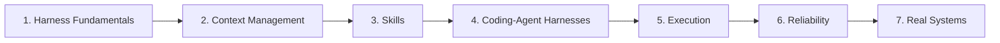

# What Is an Agent Harness?

> **TL;DR**: The *harness* is all the engineering wrapped around a hosted model — the loop that calls it, the tools it can act through, the context assembled each turn, the environment its actions run in, and the rules that keep it safe. The model is a commodity you rent; the harness is the product you build. In 2025, the gap between a demo and a shippable agent is almost entirely a harness gap, not a model gap. This chapter teaches the harness as its own engineering discipline. If you're interviewing for agent work, this is the job.

**Prerequisites**: [Agent Fundamentals](../04-agents-and-orchestration/01-agent-fundamentals.md)
**Related**: [Harness Fundamentals](01-harness-fundamentals.md), [Context Management](02-context-management.md), [Skills](03-skills.md)

---

## The Plain Definition

A **harness** is the software that turns a next-token predictor into an agent that does work. The model, on its own, only maps text to text. It cannot open a file, run a test, or remember what it did three steps ago. Every one of those capabilities is something the harness gives it:

- a **loop** that keeps calling the model until the task is done,
- a **tool layer** that turns the model's structured output into real actions,
- a **context manager** that decides what the model sees on each call,
- an **execution environment** where those actions actually happen,
- and **guardrails** — permissions and stop conditions — that keep the loop safe and finite.

Strip the harness away and you have a chatbot. Add it and you have Claude Code, Cursor, or a research agent. The intelligence comes from the model; the *agency* comes from the harness.

---

## Same Model, Different Product

Here's the point interviewers keep probing. Take one frontier model. Call it two ways:

- **Raw API call.** You paste a stack trace and ask for a fix. The model replies with a plausible diff in prose. You copy it, apply it by hand, discover it referenced a function that doesn't exist in your version, and go back and forth. The model never saw your code.
- **Coding-agent harness.** You describe the bug. The agent greps the repo, reads the three relevant files, writes an edit, runs the test suite, sees a failure, reads the traceback, fixes its own mistake, and reruns until green.

Identical weights. Wildly different experience. The second one *feels* like a smarter model, but nothing about the model changed — the harness gave it eyes (search, file reads), hands (edit, shell), and a feedback loop (run tests, read the error, retry). That delta is the whole discipline.

| What the user feels | What the harness actually did |
|---|---|
| "It understands my codebase" | Selective retrieval — searched and read only the relevant files |
| "It caught its own bug" | Verification loop — ran tests, fed the failure back in |
| "It remembers the whole task" | Context management — summarized old steps, kept the goal pinned |
| "It just knew how to do the deploy" | A skill — loaded a packaged procedure on demand |
| "It didn't nuke my main branch" | Permissions — gated destructive commands behind approval |

None of those are model upgrades. They are all harness.

---

## Why 2025 Is a Harness Story

Frontier models have converged. On raw reasoning, the top few are close enough that most product differences no longer come from picking a better base model — they come from what you build around it. Three forces pushed the leverage into the harness:

1. **Tool use and long context matured.** Models got reliable enough at calling tools and holding a long transcript that you can actually run a 50-step autonomous loop. That turns "one clever prompt" into "an orchestrated session," which is an engineering problem.
2. **The hard problems are systems problems.** Keeping a long run coherent, recovering from a failed command, not leaking secrets, stopping before you burn the budget — these are reliability and context problems, not intelligence problems. See [Reliability](06-reliability.md).
3. **The moat moved.** You don't own the model — it's a hosted dependency any competitor can also rent. What you *do* own is your tool design, your context strategy, your skills library, and your verification loops. That's where the defensible engineering lives.

> **Interview framing**: "Modern agent quality is increasingly a harness story" is a claim you should be able to defend in one breath — the models are close, so the differentiation is in the loop, the tools, the context, and the guardrails.

---

## Harness vs Framework

A common mix-up: is LangGraph a harness? Is the Agents SDK? No — those are **frameworks for building harnesses**. The distinction matters in interviews.

- A **framework** (LangGraph, CrewAI, the OpenAI Agents SDK) is a library that gives you primitives — a graph runner, a tool-calling loop, state plumbing. It's a means.
- A **harness** is the *assembled, opinionated system* around a specific model for a specific job — the actual tools you chose, the context strategy you tuned, the permissions you set. It's the product.

You can build a harness with a framework or from scratch with a bare `while` loop and the raw API — plenty of production agents are the latter. The framework is optional; the harness is not. When someone says "Claude Code's harness," they mean the concrete set of decisions that make it behave the way it does, regardless of what library (if any) sits underneath.

---

## The Chapter Map

This chapter walks the harness from the inside out. Seven topics, each its own lesson:

| # | Lesson | The question it answers |
|---|---|---|
| 1 | [Harness Fundamentals](01-harness-fundamentals.md) | What are the pieces every harness has? |
| 2 | [Context Management](02-context-management.md) | How do you keep a long run inside a finite window? |
| 3 | [Skills](03-skills.md) | How do you give an agent reusable, on-demand know-how? |
| 4 | [Coding-Agent Harnesses](04-coding-agent-harnesses.md) | What tools does a real coding agent need? |
| 5 | [Execution](05-execution.md) | How do you plan, parallelize, and resume long tasks? |
| 6 | [Reliability](06-reliability.md) | How do you make it verify, recover, and stop safely? |
| 7 | [Real Systems](07-real-systems.md) | How do Claude Code, Codex, and the SDKs actually do it? |

Start with [Harness Fundamentals](01-harness-fundamentals.md) for the anatomy, then Context Management — the highest-leverage piece — before the rest.

---

## Interview Cheat Sheet

| They ask... | The crisp answer |
|---|---|
| "What's an agent harness?" | The loop, tools, context manager, execution environment, and guardrails around a model that turn it into an agent. |
| "Model vs harness — what's the difference?" | The model is a hosted text-to-text function you rent; the harness is the product engineering that gives it agency. |
| "Why can two agents on the same model feel so different?" | Different harnesses: tool design, context management, verification, permissions. The weights are identical. |
| "Why is agent quality a harness story now?" | Frontier models have converged; the differentiation and the moat moved into the engineering around the model. |
| "Where's the defensible IP if you don't own the model?" | Tool design, context strategy, skills library, and verification loops — everything the harness owns. |

---

**Key takeaway**: The model brings the intelligence; the harness brings the agency. Two products on the same weights diverge entirely on harness decisions, which is why 2025-era agent engineering is mostly about the loop, the context, the tools, and the guardrails — not the model.

Next: [Harness Fundamentals](01-harness-fundamentals.md) — the five pieces every harness has.
